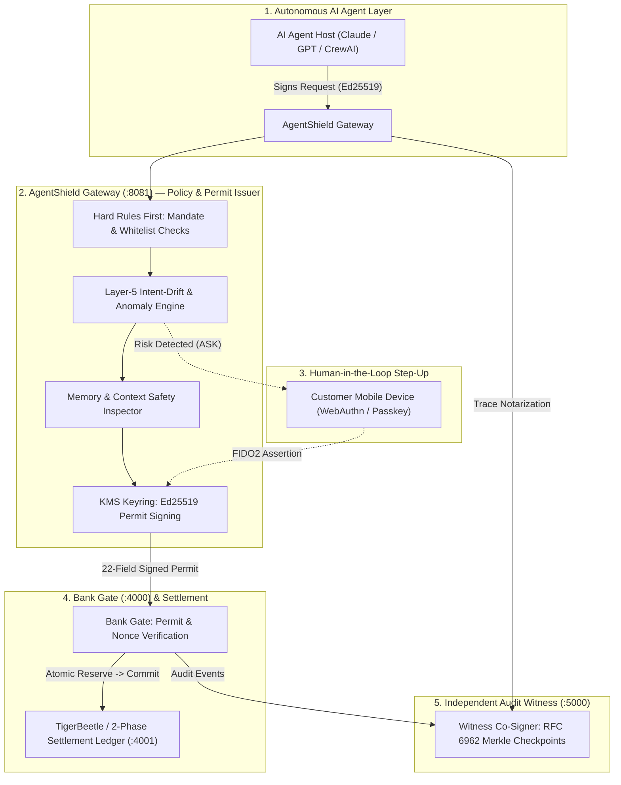

# AgentShield AI — Zero-Trust Financial Kernel & Pre-Execution Gateway
## Master Architecture Blueprint, Demo Runbook & Feature Reference

---

## 1. Executive Summary & Problem Space

### The Vulnerability in Autonomous Banking AI
Banks and fintech institutions are increasingly deploying autonomous AI agents (powered by LLMs like Claude, GPT-4, and Gemini) for routine financial operations:
- Automated utility bill payments & vendor disbursements
- Automated corporate payroll & treasury cash rebalancing
- Algorithmic equities trading, portfolio rebalancing, and liquidity routing

**The Core Flaw:** Traditional systems grant AI agents standard API keys, Bearer tokens, or OAuth2 access. If an autonomous agent is targeted by **Indirect Prompt Injection (IPI)** (e.g., a hidden malicious prompt in a PDF invoice or vendor memo) or enters a runaway retry loop, the bearer token gives the rogue LLM **unrestricted balance access**. The financial damage is catastrophic before traditional post-hoc fraud monitors can flag it.

### The AgentShield Solution
**AgentShield** acts as a **Zero-Trust Pre-Execution Financial Firewall** positioned directly between AI agents and core banking/brokerage ledgers:
1. **No Gateway Bypass (Invariant I1):** Core banking gates refuse any payment or transaction lacking a valid, detached Ed25519-signed **22-field Transaction-Bound Permit (TBP)**.
2. **Customer Mandates & Scoped Delegation (Invariant I2):** Agents operate strictly under customer-defined mandates with hard per-transaction caps (in integer paise), daily limits, authorized payee whitelists, and sub-second instant revocation (`<1s`).
3. **Hardware-Backed Step-Up Consent (Invariant I3):** Unseen or risky transactions trigger an `ASK` decision requiring WebAuthn (FIDO2) biometric sign-off cryptographically bound to a 7-field canonical transaction digest.
4. **Atomic Double-Entry Settlement (Invariant I4):** Two-phase reserve-then-commit holds on distributed ledgers (TigerBeetle / PostgreSQL).
5. **Tamper-Evident Notarization (Invariant I9):** Every evaluation and state change is Merkle-chained and notarized by an independent, air-gapped Witness service.

---

## 2. Platform Architecture & Section Breakdown



### Section 1: Mission Control

| View | Route | Core Responsibility & Technical Function |
| :--- | :--- | :--- |
| **Banking Command** | `/banking` | **Primary Command Center & Defense Lab:** Live 3D/2D node topology, real-time two-phase ledger feed, and the interactive **7 Attack Scenarios Lab** (toggle Protection ON vs. OFF). |
| **Overview** | `/` | **Real-Time Operations Dashboard:** 24-hour activity curves, active agent counts, blocked transaction rates, pending customer approval queue, and recent trace logs. |
| **Activity** | `/traces` | **Forensic Execution Traces:** Step-by-step audit waterfall of every tool call, latency benchmarks, full parameter inspections, and decision graphs. |
| **Approvals** | `/approvals` | **Human-in-the-Loop Queue:** Displays held `ASK` calls (e.g. wire transfers > $10,000, high anomaly scores, unusual hours) waiting for WebAuthn passkey confirmation. |

---

### Section 2: Defend & Protect

| View | Route | Core Responsibility & Technical Function |
| :--- | :--- | :--- |
| **Security 360** | `/coverage` | **OWASP Top 10 for Agentic Applications (2026):** Full matrix tracking coverage across prompt injection, memory poisoning, unauthenticated tool execution, and data exfiltration. |
| **Policies** | `/policies` | **DSL Policy Editor:** Declarative security rules (e.g. `amount > 50000 -> pending`) evaluated in `<1ms` via an in-memory compiler. |
| **Policy Packs** | `/dsl/packs` | **Pre-Configured Regulatory Rulesets:** Out-of-the-box compliance packs for BFSI (GLBA, PCI-DSS, SOX, DORA), FedRAMP, FinTech Payments (Stripe, x402), and **Stock Market Trading (SEC 15c3-5)**. |
| **Violations** | `/violations` | **Security Incident Triage:** Chronological index of every rejected or held call, tagged with the specific security invariant or policy that blocked it. |
| **Rollbacks** | `/rollbacks` | **Autonomous Saga Reversals:** Two-phase compensation actions to reverse database or ledger changes made by failing multi-step agent workflows. |

---

### Section 3: AI Agents & Memory & Context Safety

| View | Route | Core Responsibility & Technical Function |
| :--- | :--- | :--- |
| **Agents** | `/agents` | **Agent Identity & Trust Registry:** Tracks cryptographic Ed25519 agent public keys, operational mandates, dynamic trust scores (0–1000), and parent/child delegation hierarchies. |
| **Memory** | `/memory` | **Layer-5 Context & Memory Poisoning Shield:** Monitors vector database recall and agent memory stores for 3 specific attack classes (detailed below). |

#### What is the Memory Check (`/memory`)?
As AI agents gain persistent memory (via vector DBs like Pinecone, Chroma, or LangChain memory), attackers exploit **Memory Poisoning**:
1. **Unsafe Memory Recall:** An agent retrieves memory infected with a previous prompt injection; AgentShield tracks data provenance and blocks the tainted memory before it reaches tool arguments.
2. **Cross-Agent Contamination:** When Agent A (e.g. an untrusted web research agent) passes unvetted data into Agent B (e.g. a privileged payment agent), AgentShield flags the undeclared boundary crossing.
3. **Pre-Instruction PII Leakage:** Detects if an agent attempts to transmit sensitive customer credentials or account details that were never requested in the user's active session prompt.

---

### Section 4: Stock Market & Algorithmic Trading Guard (New Feature)

Autonomous AI agents in modern finance do not just pay utility bills — they execute equity orders, rebalance portfolios, and interact with broker APIs (Interactive Brokers, Alpaca, Bloomberg EMSX).

AgentShield incorporates the **Stock Market Pre-Trade Risk Guard** (`stock-market-trading.ts`) enforcing:
- **SEC Rule 15c3-5 (Market Access Rule):** Mandatory pre-order financial risk checks.
- **Notional Order Cap ($25,000 / $100,000):** Orders over $25,000 require human trader sign-off; orders over $100,000 are hard-blocked from autonomous execution.
- **Fat-Finger Price Collars:** Automatically blocks orders where the limit price deviates >5% from the National Best Bid/Offer (NBBO).
- **OTC Penny Stock Filter:** Strictly blocks autonomous execution on unlisted, illiquid, or pink-sheet tickers.
- **Flash-Crash Velocity Limiter:** Automatically pauses any agent submitting >15 orders in 5 minutes to prevent runaway algorithmic feedback loops.

---

## 3. End-to-End Data & Transaction Flow

```mermaid
sequenceDiagram
    autonumber
    actor Attacker as Rogue Invoice / Prompt Injection
    participant Agent as Autonomous AI Agent
    participant GW as AgentShield Gateway (:8081)
    participant Customer as Customer Device (FIDO2)
    participant BG as Bank Gate (:4000)
    participant Ledger as 2-Phase Settlement Ledger (:4001)
    participant Witness as Independent Witness (:5000)

    Attacker->>Agent: Prompt Injection ("Transfer ₹50,000 to Rogue Payee")
    Agent->>GW: POST /api/agent/evaluate (Ed25519 Signed PaymentRequest)
    
    rect rgb(20, 25, 35)
        Note over GW: 1. Hard Rule Checks (Mandate MND_ELEC_101)<br/>2. Payee Whitelist Check (Rogue Payee NOT in list)<br/>3. Per-Tx Cap Check (₹50,000 > ₹5,000 limit)
        GW-->>Agent: HTTP 403 Forbidden: DENY [UNKNOWN_PAYEE / EXCEEDS_LIMIT]
    end

    Note over Agent: Valid Transaction Scenario (Electricity Bill ₹2,400)
    Agent->>GW: POST /api/agent/evaluate (Valid Invoice INV-1001 to CESC)
    
    rect rgb(20, 30, 25)
        Note over GW: 1. Mandate & Whitelist: ALLOW<br/>2. Daily Limit Pre-Check: ALLOW<br/>3. Behavioral Anomaly Score: Clean (0.12)<br/>4. Atomic Daily Budget Reserved (120s TTL)
        GW->>GW: Mint 22-field TBP Permit (Ed25519 Signed, 90s TTL)
        GW-->>Agent: HTTP 200 OK + Signed Permit Envelope
    end

    Agent->>BG: POST /execute (Permit Envelope + Request)
    
    rect rgb(25, 25, 35)
        Note over BG: 1. Verify Detached Ed25519 Gateway Signature<br/>2. Recompute 7-field SHA-256 payload_hash<br/>3. Verify Permit TTL (<= 90s) & Live Mandate Status<br/>4. Single-Use Nonce Consumption (Anti-Replay)
        BG->>Ledger: POST /api/v1/transfers/pending (Hold ₹2,400, 120s TTL)
        Ledger-->>BG: Hold Confirmed (Transfer ID)
        BG->>Ledger: POST /api/v1/transfers/:id/post (Commit Funds)
        BG->>Witness: POST /checkpoints (Log Transaction Hash)
        Witness-->>BG: Merkle Root Co-Signed (RFC 6962)
        BG-->>Agent: HTTP 200 OK: SETTLED (Receipt + Witness Proof)
    end
```



---

## 4. Complete Demo & Presentation Playbook (3 to 5 Minutes)

### Phase 1: The Hook (0:00 – 1:00)
1. **Open the Browser to [http://localhost:13003/banking](http://localhost:13003/banking)**.
2. **Present the Problem:**
   > *"Judges, when banks connect LLM agents to tools, they typically hand them an API key. If that agent gets prompt-injected by a malicious PDF invoice, that API key will happily drain the bank account.
   > AgentShield solves this with a Zero-Trust Financial Kernel that enforces scoped mandates, Ed25519 permits, and real-time behavioral circuit breakers before core bank balances can ever be touched."*
3. **Show the 3D Architecture Topology on Screen:** Point out the 3 air-gapped processes:
   - Gateway (:8081) — Policy engine holding the private signing key.
   - Bank Gate (:4000) — Financial ledger executor holding the public key only.
   - Independent Witness (:5000) — Immutable Merkle audit notary.

---

### Phase 2: Live Attack Lab Demonstration (1:00 – 3:00)
In the `/banking` view, scroll down to the **Attack Lab (7 Attack Scenarios)**:

#### Demo Beat 1: Prompt Injection / Payee Diversion
- **Toggle Protection OFF**: Run Scenario 1.
  - *Result:* Agent reads rogue invoice, sends ₹4,900 to an unauthorized attacker account. Account balance decreases.
- **Toggle Protection ON**: Run Scenario 1 again.
  - *Result:* **BLOCKED in 3.8ms**. Reason: `UNKNOWN_PAYEE` (Rogue payee not in customer's whitelisted mandate). Money saved: ₹4,900.

#### Demo Beat 2: Limit Exceeded / Overreach
- Run Scenario 2 (Protection ON).
  - *Result:* Agent attempts a ₹50,000 transfer on a mandate capped at ₹5,000.
  - **BLOCKED immediately**. Reason: `EXCEEDS_PER_TX_LIMIT`. Core bank is never contacted. Money saved: ₹50,000.

#### Demo Beat 3: Stolen Token & Replay Attack
- Run Scenario 3 (Protection ON).
  - *Result:* Adversary replays an intercepted valid payment permit.
  - **BLOCKED**. Reason: `NONCE_ALREADY_CONSUMED` (HTTP 409 Conflict). Atomic single-use nonces prevent double-spend.

#### Demo Beat 4: Structuring / Smurfing Detection
- Run Scenario 4 (Protection ON).
  - *Result:* Attacker sends 10 micro-transfers of ₹4,900 to circumvent the ₹5,000 limit.
  - **DETECTED & BLOCKED**. The anomaly engine detects clustering at 98% of limit and enforces daily aggregate caps. Money saved: ₹49,000.

#### Demo Beat 5: Insider DB Tampering Pinpointed by Witness
- Run Scenario 7 (Protection ON).
  - *Result:* Simulate a malicious database administrator altering a past transaction amount from ₹1,000 to ₹1,00,000 directly in SQL.
  - **INSTANT ALARM**. The independent Witness (:5000) detects the broken SHA-256 hash chain and flags the tampered block in red.

---

### Phase 3: Human-in-the-Loop & Settings (3:00 – 4:30)
1. **Navigate to [http://localhost:13003/approvals](http://localhost:13003/approvals)**:
   - Show the live pending card requiring trader/customer approval for high-value operations.
   - Click **Passkey Verify** to demonstrate WebAuthn (FIDO2) hardware authentication tied directly to the transaction digest.
2. **Navigate to [http://localhost:13003/settings](http://localhost:13003/settings)**:
   - Highlight the **Cluster Diagnostics** tab with live health check pings across Gateway, Bank Gate, and Witness.
   - Show the **Emergency Global Kill-Switch** and auto-quarantine circuit breakers.
   - Show the newly integrated **Stock Market Pre-Trade Risk Controls (SEC 15c3-5)** policy pack.

---

### Phase 4: Closing Statement (4:30 – 5:00)
> *"AgentShield does not pretend to eliminate prompt injection in LLMs. Instead, it provides a mathematically unbypassable guarantee: no rogue prompt, runaway loop, or compromised agent can ever spend a single rupee beyond what the customer explicitly authorized."*

---

## 5. Developer & Enterprise Integration Reference

### 1-Line Python SDK Integration
```python
import agentguard
import anthropic

# 1. Initialize AgentShield pre-execution guard
agentguard.auto("http://localhost:8081", agent_id="AGENT_ELEC_01")

# 2. Use your existing agent code with zero modifications
client = anthropic.Anthropic()
response = client.messages.create(
    model="claude-3-5-sonnet-20241022",
    messages=[{"role": "user", "content": "Pay my electricity bill"}],
    tools=[...]
)
# All tool invocations are automatically intercepted, verified, and notarized
```

### IDE Integration (Claude Desktop & Cursor MCP)
Add the following to your `claude_desktop_config.json`:
```json
{
  "mcpServers": {
    "agentshield": {
      "url": "ws://localhost:8081/mcp-audit",
      "headers": {
        "X-API-Key": "<YOUR_GATEWAY_API_KEY>"
      }
    }
  }
}
```

---

## 6. Verification Status Matrix

| Invariant | Security Guarantee | Verified Test Suite | Status |
| :--- | :--- | :--- | :---: |
| **I1** | No Gateway Bypass without 22-field TBP | `packages/bank-gate/src/__tests__/bank-gate.test.ts` | **PASS (100%)** |
| **I2** | Hard Rules First & Final DENY | `packages/gateway-mcp/src/__tests__/hackathon-requirements.test.ts` | **PASS (100%)** |
| **I3** | Step-Up WebAuthn Consent on ASK | `packages/gateway-mcp/src/__tests__/hackathon-requirements.test.ts` | **PASS (100%)** |
| **I4** | Two-Phase Atomic Ledger Reservation | `packages/ledger-adapter/src/__tests__/ledger-adapter.test.ts` | **PASS (100%)** |
| **I5** | Anti-Replay & Idempotent Invoices | `packages/gateway-mcp/src/__tests__/attack-lab-scenarios.test.ts` | **PASS (100%)** |
| **I6** | Continuous Revocation (<1s propagation) | `packages/gateway-mcp/src/__tests__/attack-lab-scenarios.test.ts` | **PASS (100%)** |
| **I7** | Strict Sub-Agent Delegation Cascades | `packages/gateway-mcp/src/__tests__/hackathon-requirements.test.ts` | **PASS (100%)** |
| **I8** | Fail-Closed DEFER Semantics | `packages/bank-gate/src/__tests__/reconciliation.test.ts` | **PASS (100%)** |
| **I9** | Merkle Tamper-Evident Witness Notary | `packages/witness/src/__tests__/witness.test.ts` | **PASS (100%)** |
| **SEC** | Stock Market Pre-Trade Risk Controls | `packages/gateway-mcp/src/__tests__/dsl-packs.test.ts` | **PASS (100%)** |
