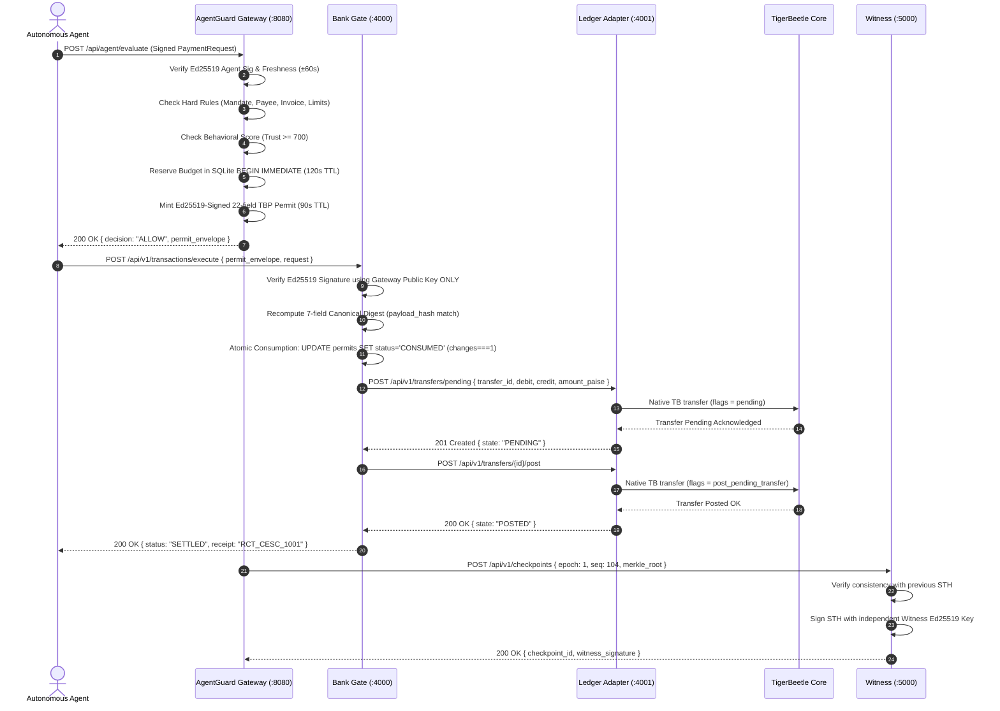
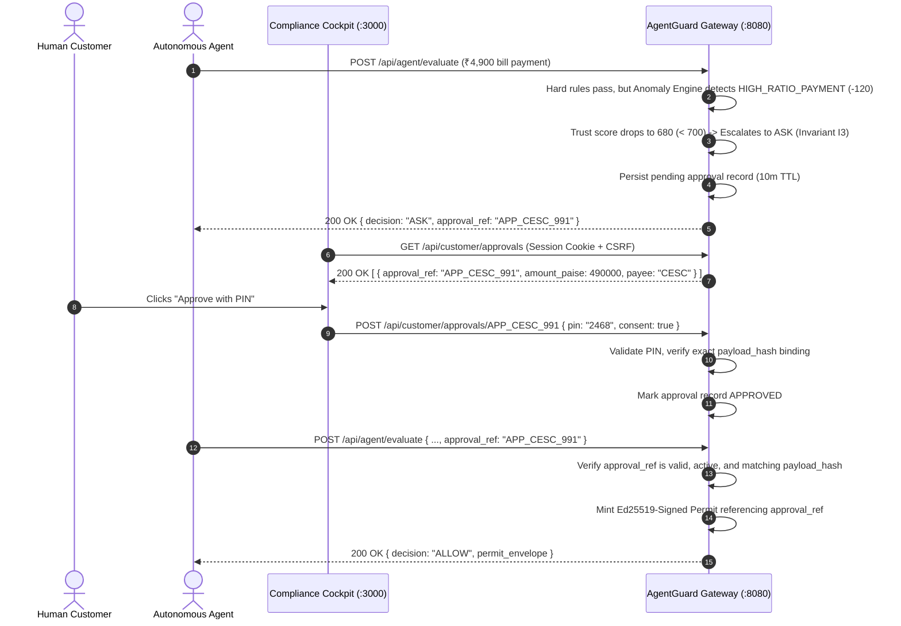
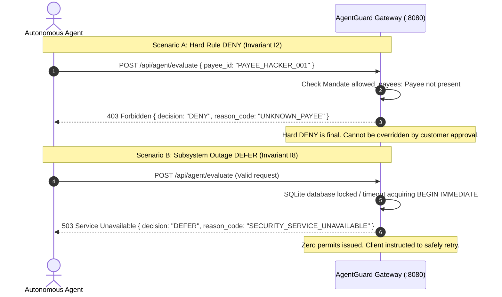
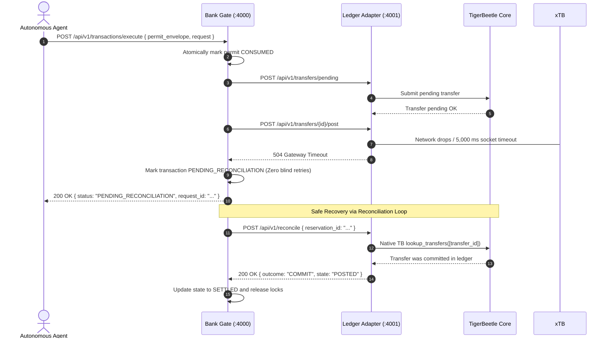
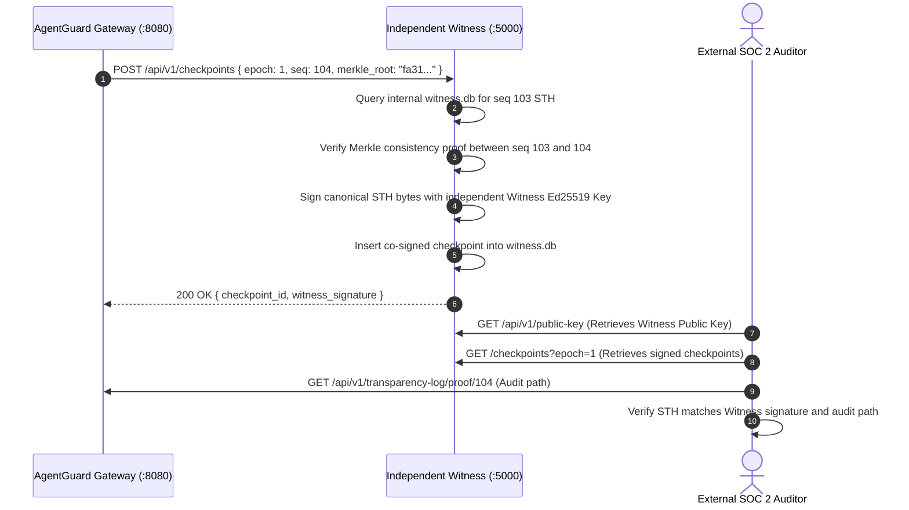

# AgentGuard AI — Service API Contracts & Communication Guide
**Document:** `docs/API-CONTRACTS.md`  
**Version:** 1.0.0 (Phase 1.4 API Contracts & OpenAPI)  
**Status:** APPROVED SPECIFICATION  
**Target Git Branch:** `feat/agentguard-banking`  
**Authors:** Principal API Architect, Senior Banking Systems Engineer, Application Security Engineer  

---

## 1. Executive Summary & Service Topology

This document specifies the exact API contracts, error conventions, idempotency semantics, and inter-service communication protocols governing the **AgentGuard AI** banking security platform.

The architecture strictly enforces the three-process isolation model (**Decision D1**):
```
┌────────────────────────────────┐       Signed Permit + Request      ┌────────────────────────────────┐
│   AgentGuard Gateway (:8080)   ├───────────────────────────────────►│        Bank Gate (:4000)       │
│  - Evaluates agent intent      │                                    │  - Verifies Ed25519 signature  │
│  - Mints 22-field TBP permit   │                                    │  - Verifies 7-field digest     │
│  - Holds Ed25519 private key   │                                    │  - Holds public key ONLY (E4)  │
└───────────────┬────────────────┘                                    └───────────────┬────────────────┘
                │                                                                     │
                │ Co-Sign Checkpoints                                                 │ Two-Stage Transfers
                ▼                                                                     ▼
┌────────────────────────────────┐                                    ┌────────────────────────────────┐
│    Independent Witness (:5000) │                                    │   TigerBeetle Ledger (:4001)   │
│  - Standalone process & DB     │                                    │  - Integer paise double entry  │
│  - Independent Ed25519 key     │                                    │  - Pending -> Post / Void      │
│  - Merkle consistency checks   │                                    │  - 128-bit transfer IDs        │
└────────────────────────────────┘                                    └────────────────────────────────┘
```

### OpenAPI Specifications
The complete OpenAPI 3.1 definitions are published in:
- **Bank Gate (`:4000`):** [`docs/api/openapi-bank-gate.yaml`](file:///s:/trail/AGENTGUARD-AI/docs/api/openapi-bank-gate.yaml)
- **Ledger Adapter (`:4001`):** [`docs/api/openapi-ledger.yaml`](file:///s:/trail/AGENTGUARD-AI/docs/api/openapi-ledger.yaml)
- **Independent Witness (`:5000`):** [`docs/api/openapi-witness.yaml`](file:///s:/trail/AGENTGUARD-AI/docs/api/openapi-witness.yaml)

---

## 2. Shared API Conventions & Standard Behaviors

### 2.1 API Versioning
All service endpoints are versioned under `/api/v1/*` with the exception of standard unauthenticated `/health` endpoints and legacy aliases mandated by [`CONTRACTS.md`](file:///s:/trail/AGENTGUARD-AI/CONTRACTS.md).

### 2.2 Correlation & Tracing Headers
Every HTTP request across services must propagate:
- `X-Correlation-ID`: Client-generated or Gateway-issued UUIDv4 correlating logs, OpenTelemetry spans, and audit records.
- `Idempotency-Key`: UUIDv4 header required on all state-mutating requests (`/execute`, `/transfers/pending`). Matches the `request_id`.

### 2.3 Strict Integer Paise Representation (Rule E1)
- All financial amounts must be represented as **positive integer paise** (e.g., ₹5,000.00 is strictly `500000`).
- No floating-point values are permitted in JSON payloads or database columns.
- Currency is strictly `INR` (**CONTRACTS.md**).

### 2.4 Timestamp Precision (Rule E2 & Rule E3)
- All timestamps in JSON payloads and headers must be **integer UTC epoch milliseconds** (`timestamp_ms`, `issued_at`, `expires_at`, `created_at`).
- Business logic evaluates time strictly using the injected `Clock` interface (`{ now(): number }`).
- `Asia/Kolkata` (IST) is used strictly for daily budget windowing (`kolkataDay`).

### 2.5 Standard Error Response Schema
All services return a consistent error envelope on HTTP $4\text{xx}$ and $5\text{xx}$ responses:
```json
{
  "error": "Permit has already been consumed and cannot be reused",
  "reason_code": "PERMIT_ALREADY_CONSUMED",
  "details": {
    "permit_id": "223e4567-e89b-12d3-a456-426614174001",
    "consumed_at": 1795000002000
  },
  "timestamp": 1795000005000
}
```

### 2.6 HTTP Status Code Definitions
- `200 OK`: Request succeeded (transfer settled, decision ALLOW, or verification passed).
- `201 Created`: Resource successfully created (pending transfer created).
- `400 Bad Request`: Schema validation failure, non-integer paise, malformed JSON, or missing headers.
- `401 Unauthorized`: Missing or invalid Ed25519 signature, or cross-namespace credential misuse (**Rule E5**).
- `403 Forbidden`: Security policy violation (e.g., `MANDATE_REVOKED`, `PAYLOAD_DIGEST_MISMATCH`, `SUBAGENT_SCOPE_EXCEEDED`).
- `404 Not Found`: Mandate, permit, account, or transfer does not exist.
- `409 Conflict`: Concurrency violation, permit already consumed, or duplicate `request_id` reuse with mismatched parameters (**Invariant I5**).
- `422 Unprocessable Entity`: Financial constraint failure (e.g., `INSUFFICIENT_FUNDS` in integer paise balance).
- `429 Too Many Requests`: Rate limit exceeded (token bucket exhausted).
- `503 Service Unavailable`: Fail-closed state (`DEFER: SECURITY_SERVICE_UNAVAILABLE`) due to database lock or ledger outage (**Invariant I8**).
- `504 Gateway Timeout`: Ledger or downstream socket timeout. Transaction transitions to `PENDING_RECONCILIATION`.

---

## 3. Canonical Serialization & Deterministic Digest (RFC 8785)

To guarantee that transaction authorization is tamper-proof across multiple programming languages (TypeScript, Python, Go), the 7-field canonical transaction digest follows **RFC 8785 (JSON Canonicalization Scheme)** rules:
1. Keys are strictly sorted in lexicographical ASCII order:
   `["account_ref", "action", "amount_paise", "currency", "invoice_ref", "payee_id", "purpose"]`
2. No extra whitespace between keys, colons, or commas.
3. String values use standard JSON string escaping without trailing nulls.
4. Output is digested using SHA-256 and represented as a lowercase 64-character hex string.

### Test Vector (Cross-Language Reference — RFC 8785)
```json
{"account_ref":"ACC_101","action":"bill_payment","amount_paise":240000,"currency":"INR","invoice_ref":"INV-1001","payee_id":"PAYEE_CESC_001","purpose":"electricity_bill"}
```
- **UTF-8 Byte Length:** 173 bytes
- **SHA-256 Digest:** `b566a992326ebc84abb6c1e5ffbc66794233e303694cf3acf34a50a37a585330`
*(Verified identical across Node.js `crypto`, Python `hashlib`, and Go `crypto/sha256`)*

---

## 4. Service Endpoint Matrices

### 4.1 Bank Gate (`:4000`)
| Method | Path | Auth / Required Credentials | Summary | Invariants Enforced |
| :--- | :--- | :--- | :--- | :---: |
| `GET` | `/health` | None | Health check & uptime | N/A |
| `POST` | `/api/v1/permits/verify` | Internal / Permit Envelope | Verifies Ed25519 signature & 7-field digest | **I1, I6** |
| `POST` | `/api/v1/transactions/authorize`| Gateway / Agent Token | Pre-flight mandate & standing check | **I2** |
| `POST` | `/api/v1/transactions/execute`| Signed 22-field TBP Envelope | Atomically consumes permit & posts ledger transfer | **I1, I4, I6** |
| `POST` | `/execute` | Signed 22-field TBP Envelope | Legacy alias matching CONTRACTS.md Section 6 | **I1, I6** |
| `GET` | `/api/v1/transactions/{id}` | Internal / Agent Token | Returns transaction execution record | N/A |
| `POST` | `/api/v1/transactions/{id}/reconcile`| Operator / Recovery Token | Reconciles PENDING_RECONCILIATION transfers | **I4, I6** |
| `POST` | `/reconcile` | Operator / Recovery Token | Legacy alias matching CONTRACTS.md Section 6 | **I4, I6** |
| `POST` | `/api/v1/mandates/{id}/revoke`| Gateway Event / Internal | Evicts mandate from cache immediately | **I6** |

### 4.2 Ledger Adapter (`:4001`)
| Method | Path | Auth Level | Summary | Semantics |
| :--- | :--- | :--- | :--- | :--- |
| `GET` | `/health` | None | TigerBeetle cluster connectivity | Replica status |
| `GET` | `/api/v1/accounts/{ref}` | Internal (Bank Gate only) | Account lookup | Metadata |
| `GET` | `/api/v1/accounts/{ref}/balance`| Internal (Bank Gate only) | Liquid vs reserved balances | Integer paise |
| `POST` | `/api/v1/transfers/pending` | Internal (Bank Gate only) | Creates stage-1 pending transfer | 120s TTL lock |
| `POST` | `/api/v1/transfers/{id}/post` | Internal (Bank Gate only) | Stage-2 commit (Permanent settlement) | Commits debit |
| `POST` | `/api/v1/transfers/{id}/void` | Internal (Bank Gate only) | Stage-2 cancel (Releases locked funds) | Voids lock |
| `GET` | `/api/v1/transfers/{id}` | Internal (Bank Gate only) | Lookup transfer state by 128-bit ID | Query |
| `POST` | `/api/v1/reconcile` | Internal (Bank Gate only) | Safe recovery lookup before state update | Zero blind debit |

### 4.3 Independent Witness (`:5000`)
| Method | Path | Auth Level | Summary | Semantics |
| :--- | :--- | :--- | :--- | :--- |
| `GET` | `/health` | None | Witness health & signed count | Liveness |
| `GET` | `/api/v1/public-key` | None | Witness Ed25519 public key (PEM) | Public key |
| `GET` | `/public-key` | None | Legacy alias matching CONTRACTS.md | Public key |
| `POST` | `/api/v1/checkpoints` | Gateway Authenticated | Submits Merkle root for co-signing | Co-sign STH |
| `GET` | `/checkpoints` | Auditor / Public | List co-signed checkpoints by epoch | Query STH log |
| `GET` | `/api/v1/checkpoints/{id}` | Auditor / Public | Retrieve specific checkpoint record | Query |
| `POST` | `/api/v1/checkpoints/verify` | Auditor / Public | Verifies event inclusion in Merkle STH | Offline Proof |

---

## 5. End-to-End Sequence Diagrams

### 5.1 Diagram 1: Normal Successful Transaction (`ALLOW` $\rightarrow$ Settled)



---

### 5.2 Diagram 2: Customer Approval (`ASK`) Workflow



---

### 5.3 Diagram 3: `DENY` and `DEFER` Workflows



---

### 5.4 Diagram 4: Ledger Timeout and Safe Reconciliation (`PENDING_RECONCILIATION`)



---

### 5.5 Diagram 5: Witness Checkpoint Verification & Co-Signing



---

## 6. Contract Consistency & Governance Verification

| Governance Contract | Definition in CONTRACTS.md | OpenAPI Representation | Zod Schema Implementation |
| :--- | :--- | :--- | :--- |
| **PaymentRequest** | Section 1 (15 fields) | `PaymentRequest` in Bank Gate spec | `PaymentRequestSchema` in `transaction.ts` |
| **Canonical Digest**| Section 2 (7 fields) | `CanonicalTransaction` in Bank Gate spec | `CanonicalTransactionSchema` in `transaction.ts` |
| **Permit v1 Payload**| Section 3 (22 fields) | `TransactionBoundPermitPayload` | `TransactionBoundPermitPayloadSchema` in `transaction.ts` |
| **Permit Envelope** | Section 3 (`permit` + `signature`)| `PermitEnvelope` | `PermitEnvelopeSchema` in `transaction.ts` |
| **TTL Constants** | Section 4 (90s / 120s / 600s) | Headers & operation comments | Verified in `banking.test.ts` |
| **Reason Codes** | Section 5 (Fixed enums) | `reason_code` in error schemas | `GatewayDenyReasonSchema`, `BankDenyReasonSchema` |
| **HTTP Endpoints** | Section 6 (:8080, :4000, :5000)| Bank Gate, Ledger & Witness OpenAPI | Fully routed & specified |

---

## 7. Phase 7.1 Enterprise Identity & Step-Up Endpoints (Gateway :8080)

| Endpoint | Method | Auth | Description |
|:---|:---:|:---|:---|
| `/api/customer/auth/oidc/init` | `POST` | Public | Initiates PKCE S256 authorization flow, returning `authorization_url` and `state`. |
| `/api/customer/auth/oidc/callback` | `POST` | Public | Exchanges authorization code, cryptographically validates ID token signature, and issues session cookie. |
| `/api/customer/webauthn/register/options`| `POST` | Session | Generates FIDO2 registration options (`PublicKeyCredentialCreationOptionsJSON`). |
| `/api/customer/webauthn/register/verify` | `POST` | Session | Cryptographically verifies attestation response and stores credential public key. |
| `/api/customer/webauthn/auth/options` | `POST` | Public | Generates WebAuthn authentication options for customer's enrolled passkeys. |
| `/api/customer/webauthn/auth/verify` | `POST` | Public | Verifies assertion signature against stored public key, validates counter, and issues session. |
| `/api/customer/webauthn/credentials` | `GET` | Session | Lists active passkeys registered to the authenticated customer. |
| `/api/customer/webauthn/credentials/:id/revoke` | `POST` | Session | Revokes a registered passkey. |
| `/api/customer/webauthn/credentials/:id` | `PATCH` | Session | Renames a passkey nickname. |
| `/api/customer/approvals/challenge` | `POST` | Session | Creates transaction-bound approval challenge bound to 7-field canonical digest. |
| `/api/customer/approvals/:approvalId/verify` | `POST` | Session | Cryptographically verifies WebAuthn assertion, transitioning approval to `APPROVED`. |
| `/api/customer/approvals/:approvalId` | `GET` | Session | Retrieves status and details of an approval challenge. |

---
*End of API Contracts Specification (`docs/API-CONTRACTS.md`).*
