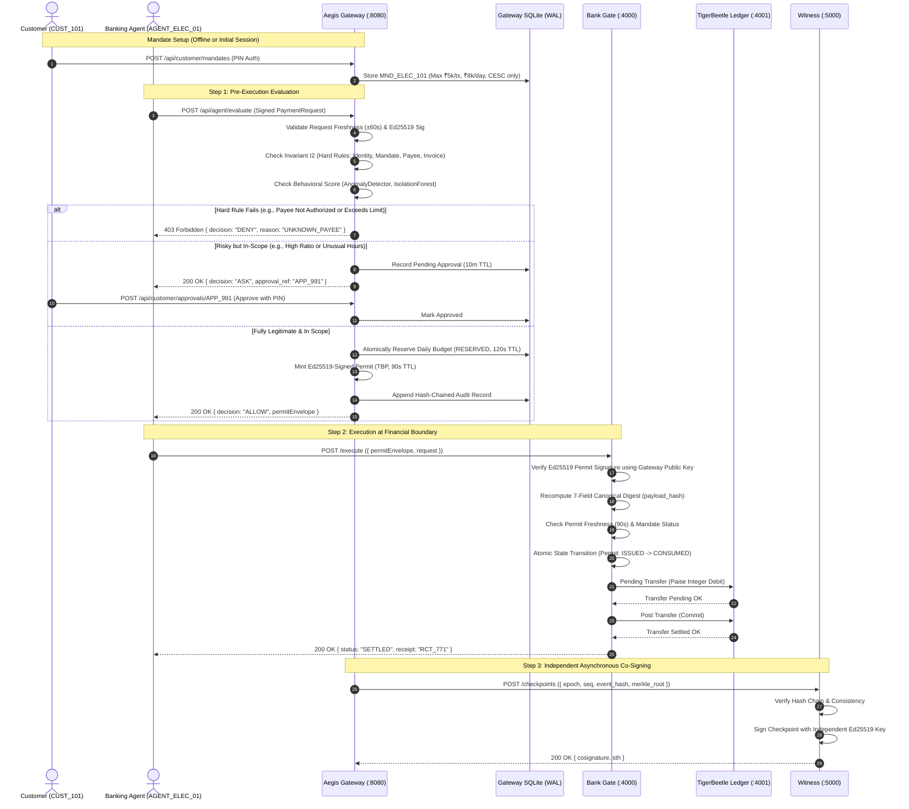
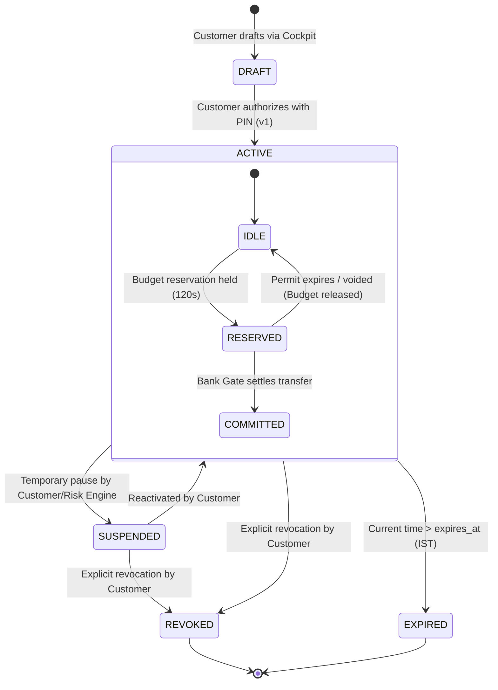
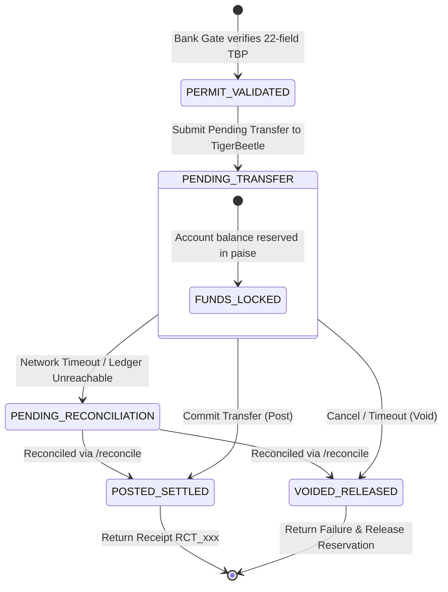
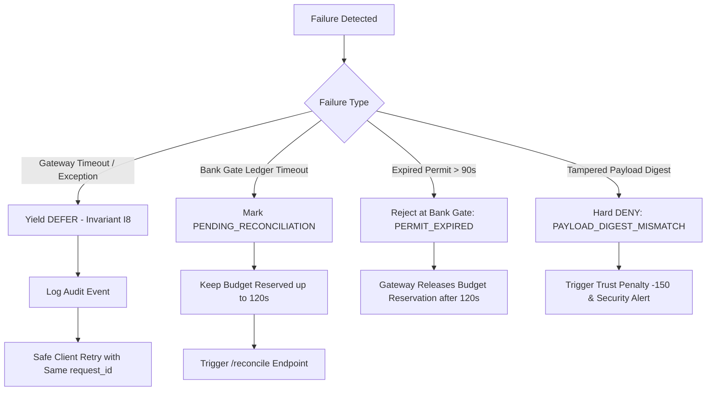

# AgentGuard AI — Banking Architecture Specification
**Document:** `docs/BANKING-ARCHITECTURE.md`  
**Version:** 1.0.0 (Phase 1.1 Architecture Reconciliation)  
**Status:** APPROVED FOR IMPLEMENTATION  
**Target Git Branch:** `feat/agentguard-banking`  
**Author:** Principal Software Architect, Senior Banking Systems Engineer, Application Security Architect  

---

## 1. Executive Architecture Overview

AgentGuard AI is an **intent-bound runtime security firewall, authorization engine, and immutable audit layer for autonomous banking agents**. 

The fundamental premise of AgentGuard AI is:
> **Trust every agent. Authorize every action.**  
> Authentication is not authorization. Verifying an AI agent's credentials does not prove that an outbound financial transaction matches the customer's true intent.

AgentGuard AI enforces a **zero-trust, deterministic security boundary** between generative AI agents and core banking infrastructure. While Large Language Models (LLMs) or agent frameworks plan actions and draft tool calls, **no AI model is ever the final authority for a financial transfer**. Every monetary action is intercepted, validated against customer mandates, checked for behavioral drift, bound to a cryptographic single-use permit, executed atomically on an integer ledger, and co-signed by an independent witness.

### High-Level System Topology

```mermaid
flowchart TD
    subgraph Clients["Clients & Agents"]
        CA["Customer Web / Mobile Banking App"]
        AG["AI Banking Agent (Python / JS SDK)"]
    end

    subgraph Gateway["AgentGuard Gateway (:8080)"]
        GW_AUTH["Auth & Namespace Isolation (E5)"]
        GW_PROV["Instruction Provenance Engine"]
        GW_ANOM["Behavioral Risk & Anomaly Detector"]
        GW_HARD["Deterministic Hard Rules Evaluator (I2)"]
        GW_PERM["Permit Issuer (Ed25519 Private Key) (D1)"]
        GW_DB[("SQLite WAL State & Audit (D2)")]
    end

    subgraph BankGate["Bank Gate (:4000)"]
        BG_VERIFY["Permit Verifier (Ed25519 Public Key Only) (I1, I6)"]
        BG_INTENT["7-Field Canonical Digest Checker (D5)"]
        BG_REPLAY["Atomic Nonce & Permit Consumer (I6)"]
        BG_STATE[("Bank Gate SQLite State")]
    end

    subgraph Ledger["Financial Ledger (:4001 Adapter)"]
        TB_ADAPTER["TigerBeetle / Memory Ledger Adapter"]
        TB_CORE[("TigerBeetle Integer Paise Ledger (E1)")]
    end

    subgraph WitnessService["Independent Witness (:5000)"]
        WIT_VERIFY["Merkle Inclusion & Consistency Verifier"]
        WIT_SIGN["Independent Ed25519 Key Pair (D10)"]
        WIT_LOG[("Witness Checkpoint Log")]
    end

    subgraph CockpitUI["Compliance Cockpit (:3000)"]
        UI_DASH["Banking Operations & Approvals (E7)"]
        UI_3D["Interactive 3D Agent Topology (R3F)"]
        UI_2D["Accessible 2D ReactFlow Fallback"]
    end

    CA -->|1. PIN Session + CSRF (E5)| GW_AUTH
    AG -->|2. Ed25519-Signed PaymentRequest (E5)| GW_AUTH
    GW_AUTH --> GW_PROV --> GW_ANOM --> GW_HARD
    GW_HARD -->|If Valid & In Scope| GW_PERM
    GW_PERM -->|Issues 22-field TBP + 120s Reservation| GW_DB
    
    AG -->|3. Forward Signed Permit + Request| BG_VERIFY
    BG_VERIFY --> BG_INTENT --> BG_REPLAY
    BG_REPLAY -->|4. Commit Transfer (Two-Stage Pending -> Post)| TB_ADAPTER
    TB_ADAPTER --> TB_CORE

    GW_DB -.->|5. Merkle Root Checkpoint| WIT_VERIFY
    WIT_VERIFY --> WIT_SIGN --> WIT_LOG

    CockpitUI -->|Operator & Customer Review| Gateway
    CockpitUI -->|Audit Verification| WitnessService
```

---

## 2. Existing vs. New Component Map

AgentGuard AI preserves the existing mature TypeScript monorepo and integrates the banking payment firewall additively:

| Component | Port | Status | Package Path | Preserved vs. New Responsibilities |
| :--- | :--- | :--- | :--- | :--- |
| **AgentGuard Gateway** | `8080` | **Preserved & Extended** | `packages/gateway-mcp` | **Preserved:** Express server, OTel instrumentation, policy engine, anomaly detector, Merkle transparency log, approvals API.<br>**Extended:** Add banking endpoints (`/api/agent/evaluate`, `/api/customer/*`, `/api/v1/banking/permit-key`). |
| **Core Schema** | N/A | **Preserved & Extended** | `packages/core-schema` | **Preserved:** Existing Zod schemas (`ToolCallSchema`, `TraceRecord`, `provenance.ts`).<br>**Extended:** Add banking schemas in `src/banking/` (`mandate.ts`, `transaction.ts`, `ledger.ts`, `clock.ts`). |
| **Bank Gate** | `4000` | **New Service** | `packages/agentguard-bank` | **New:** Independent authorization process holding **Ed25519 public key only**. Verifies 22-field TBP envelope, checks 7-field canonical hash, consumes single-use nonces, and commits ledger transfers. |
| **Ledger Adapter** | `4001` | **New Service / Module** | `packages/agentguard-bank/src/ledger` | **New:** Integer paise double-entry accounting adapter interfacing with TigerBeetle native protocol (or in-memory mock for dev/CI). Two-stage Pending $\rightarrow$ Post/Void lifecycle. |
| **Witness Service** | `5000` | **New Independent Service** | `packages/witness` | **New:** Standalone daemon possessing its own independent Ed25519 keypair. Co-signs Merkle STHs and provides independent audit verification. |
| **Compliance Cockpit** | `3000` | **Preserved & Extended** | `apps/compliance-cockpit` | **Preserved:** Next.js 14 dashboard, dark theme CSS variables, trace waterfall, violations, compliance PDF exports.<br>**Extended:** Add `/banking` route (mandates, approvals, 3D topology with 2D ReactFlow fallback, ledger view). |

---

## 3. Service Responsibility Matrix

| Feature / Responsibility | Gateway (`:8080`) | Bank Gate (`:4000`) | Ledger (`:4001`) | Witness (`:5000`) | Cockpit (`:3000`) |
| :--- | :---: | :---: | :---: | :---: | :---: |
| **Agent Request Auth (Ed25519)** | **Owns** | Re-verifies | No | No | No |
| **Customer PIN Session Auth** | **Owns** | No | No | No | Proxies |
| **Customer Mandate Lifecycle** | **Owns** | Reads Status | No | No | Manages UI |
| **Instruction Provenance Scoring** | **Owns** | No | No | No | Visualizes |
| **Behavioral Anomaly Detection** | **Owns** | No | No | No | Visualizes |
| **Permit Minting (TBP)** | **Owns (Private Key)** | **Strictly Forbidden (E4)**| No | No | No |
| **Permit Verification** | Pre-checks | **Owns (Public Key)** | No | No | No |
| **Canonical Digest Verification** | Computes | **Enforces** | No | No | No |
| **Budget Reservation (120s TTL)**| **Owns (Pre-check)** | Commits / Releases | No | No | Reads |
| **Single-Use Permit Consumption**| No | **Owns (Atomic)** | No | No | No |
| **Ledger Account Balances** | No | Triggers | **Owns (Integer)**| No | Reads |
| **Two-Stage Execution (Pending/Post)**| No | **Owns State Machine**| Executes | No | Reads |
| **Independent STH Co-signing** | Submits | No | No | **Owns (Private Key)**| Queries |
| **3D & 2D Topology Rendering** | Feeds Data | No | No | No | **Owns Rendering**|

---

## 4. Service-to-Service Communication Flow

### 4.1 End-to-End Payment Authorization Flow



---

## 5. Authentication, Authorization & Key Ownership

### 5.1 Trust Boundary and Key Management Matrix

Strict isolation of cryptographic keys is a hard security invariant (**Rule D1, Invariant I1, Rule E4**):

```
┌─────────────────────────────────────────────────────────────────────────────┐
│ TRUST BOUNDARY A: AgentGuard Gateway (:8080)                                │
│   Holds: Gateway Ed25519 Private Key (`permit_signing_private_key`)         │
│   Can: Mint 22-field Transaction-Bound Permits (TBP)                         │
│   Cannot: Access TigerBeetle ledger, move funds, or hold ledger credentials │
└──────────────────────────────────────┬──────────────────────────────────────┘
                                       │ Permits signed with Private Key
                                       ▼
┌─────────────────────────────────────────────────────────────────────────────┐
│ TRUST BOUNDARY B: Bank Gate (:4000)                                         │
│   Holds: Gateway Ed25519 Public Key ONLY (`permit_signing_public_key`)     │
│   Cannot: Mint permits (compile-time blocked via Rule E4)                   │
│   Can: Verify permits, consume single-use nonces, execute ledger transfers  │
└──────────────────────────────────────┬──────────────────────────────────────┘
                                       │ Double-entry transfers
                                       ▼
┌─────────────────────────────────────────────────────────────────────────────┐
│ TRUST BOUNDARY C: TigerBeetle Financial Ledger (:4001)                      │
│   Holds: Immutable double-entry accounts in integer paise                   │
│   Access: Restricted to Bank Gate exclusively                               │
└─────────────────────────────────────────────────────────────────────────────┘

┌─────────────────────────────────────────────────────────────────────────────┐
│ TRUST BOUNDARY D: Independent Witness (:5000)                               │
│   Holds: Independent Witness Ed25519 Key Pair                               │
│   Cannot: Access Gateway DB, Bank Gate DB, or Ledger                        │
│   Can: Verify Merkle proofs and co-sign transparency checkpoints             │
└─────────────────────────────────────────────────────────────────────────────┘
```

### 5.2 Namespace & Transport Security (Rule E5)

1. **Agent Namespace (`/api/agent/*` on :8080):**
   - Requires HTTP Header `X-Agent-Signature`: EdDSA JWS signature computed over canonical JSON request body.
   - Requires public key registered in `agent_registry`.
   - Customer credentials (cookies/tokens) explicitly rejected with HTTP 401.
2. **Customer Namespace (`/api/customer/*` on :8080):**
   - Requires HttpOnly, Secure `session_token` cookie minted via PIN authentication (`POST /api/customer/login`, default demo PIN `2468`).
   - Requires HTTP Header `X-CSRF-Token` matching session secret.
   - Agent credentials explicitly rejected with HTTP 401.
3. **Internal Bank Gate (`POST /execute` on :4000):**
   - Open to authorized agent SDKs or Gateway relay.
   - Authenticated strictly via the cryptographically signed `permitEnvelope`.

---

## 6. Customer Mandate Lifecycle

A Mandate is the root of delegated authority granted by a human customer to an AI agent:



### Mandate Invariants
- **Immutability & Versioning:** Any update to an active mandate increments its `mandate_version` (e.g., `v1` $\rightarrow$ `v2`). Any in-flight permit referencing an older version is immediately rejected by Bank Gate (**Invariant I6**).
- **Strict Expiry:** Checked against the injected deterministic `Clock` in integer milliseconds (**Rule E2, Rule D4**).
- **Dual Budgeting:**
  - `per_tx_limit_paise`: Hard upper bound for a single execution.
  - `daily_limit_paise`: Hard ceiling evaluated across `Asia/Kolkata` midnight-to-midnight day boundaries (`kolkataDay`).

---

## 7. Transaction Authorization Lifecycle (The 4 Decisions)

Every incoming `PaymentRequest` must result in exactly one of four deterministic outcomes:

```
                            [ PaymentRequest ]
                                    │
                                    ▼
                      ┌───────────────────────────┐
                      │  Hard Security Rules (I2) │
                      │  - Identity & Signatures  │
                      │  - Mandate & Expiry       │
                      │  - Payee & Invoice Match  │
                      │  - Daily Budget Pre-check │
                      └─────────────┬─────────────┘
                                    │
                  ┌─────────────────┴─────────────────┐
               Fails                               Passes
                  │                                   │
                  ▼                                   ▼
              [ DENY ]                  ┌───────────────────────────┐
       (Hard Security Block)            │   Behavioral Anomaly &    │
      *Never escalates to ASK           │   Drift Scoring Engine    │
                                        └─────────────┬─────────────┘
                                                      │
                                    ┌─────────────────┴─────────────────┐
                             Score >= 700                        Score < 700
                             (No Anomaly)                    (Risky but In-Scope)
                                    │                                   │
                                    ▼                                   ▼
                                [ ALLOW ]                            [ ASK ]
                        (Issue 90s Permit TBP)              (Customer Confirmation)
                                                                        │
                                                          ┌─────────────┴─────────────┐
                                                       Approved                    Rejected / Expired
                                                          │                               │
                                                          ▼                               ▼
                                                      [ ALLOW ]                       [ DENY ]

* Note: Any unhandled exception, DB lock, or subsystem timeout immediately yields [ DEFER ] (Fail-Closed, Invariant I8).
```

### Detailed Decision Specifications

| Decision | System Meaning | Permit Issued? | Ledger Impact | Customer Interaction |
| :--- | :--- | :---: | :---: | :--- |
| **`ALLOW`** | All hard rules pass; behavioral score is healthy ($\ge 700$ trust). | **YES** (90s TTL) | Daily budget reserved (120s TTL) | Autonomous execution proceeds. |
| **`DENY`** | Hard security violation (revoked agent, wrong payee, over limit, tampered invoice). | **NO** | Zero impact | Blocked. Action cannot be overridden by customer approval. |
| **`ASK`** | Valid within mandate, but triggers risk signals (velocity burst, unusual hours, high ratio). | **NO** (Suspended) | Zero impact until approved | Paused. Pushed to `/approvals` drawer for explicit customer PIN consent. |
| **`DEFER`** | Security service degraded, database busy, or downstream timeout. | **NO** | Zero impact | Suspended fail-closed (**Invariant I8**). Agent receives safe retry hint. |

---

## 8. Ledger Execution Lifecycle & Two-Stage Commit

Execution follows **strict two-stage financial semantics (Pending $\rightarrow$ Post/Void)** to ensure crash-safety:



### 8.1 Crash-Safe State Machine & Reconciliation
1. **Atomic Consumption (Invariant I6):**
   ```sql
   UPDATE permits 
   SET status = 'CONSUMED', consumed_at = ? 
   WHERE permit_id = ? AND status = 'ISSUED';
   -- Verified strictly by: changes === 1
   ```
2. **Crash Scenario Handling:**
   - If the network drops *after* the permit is marked `CONSUMED` but *before* TigerBeetle confirms:
     The transaction is marked `PENDING_RECONCILIATION`.
   - The operator or automated recovery loop calls Bank Gate `POST /reconcile` with `{ reservation_id, outcome: "COMMIT" | "RELEASE" }`.
   - Idempotency key `request_id` ensures that retries never double-debit an account.

---

## 9. Witness & Audit Verification Lifecycle

AgentGuard maintains two distinct audit proofs:
1. **Primary Gateway Audit Chain:** SQLite append-only log with SHA-256 hash chaining inside `BEGIN IMMEDIATE` transactions (**Rule D2, Invariant I9**).
2. **RFC 6962 Transparency Log:** Gateway Merkle tree producing Signed Tree Heads (STH).
3. **Independent Witness Co-Signing (Rule D10):**
   - The Witness runs on Port `5000` with its own isolated Ed25519 keypair.
   - Periodically fetches `GET /witness/sth-to-sign` from Gateway.
   - Verifies inclusion and consistency proofs independently.
   - Appends its detached co-signature and records the checkpoint.
   - Any split-view attack or retroactive log alteration is mathematically detectable by third-party auditors.

---

## 10. Failure and Recovery Strategy



---

## 11. Frontend Integration Strategy (Cockpit at `:3000`)

The Compliance Cockpit ([`apps/compliance-cockpit`](file:///s:/trail/AGENTGUARD-AI/apps/compliance-cockpit)) will be extended with a dedicated **Banking Operations & Governance Center**:

### 11.1 New Navigation Route: `/banking`
1. **Overview Tab:** Live banking metrics (Paise throughput, active mandates, reserved vs settled funds, trust scores).
2. **Mandates Tab:** Customer view to register, configure limits, inspect, suspend, or revoke mandates.
3. **Approvals Drawer:** High-risk `ASK` actions requiring customer PIN confirmation.
4. **Transactions Table:** Real-time log of `ALLOW`, `DENY`, `ASK`, and `DEFER` transactions with 7-field canonical hash inspection.
5. **Interactive 3D Agent Topology:**
   - Built using **React Three Fiber (R3F)** and **Drei**.
   - **Semantic Visuals:** Nodes represent Agents, Tools, Bank Gate, and Accounts. Edges represent delegation and permits. Color-coded by risk (Cyan = Verified, Amber = ASK, Red = DENY/Blocked).
   - **Accessibility & 2D Fallback:** Automatically provides an accessible toggle to the existing 2D `ReactFlow` graph and respects `prefers-reduced-motion`.
6. **Zero-CDN Compliance (Rule E7):** All icons (Lucide), fonts (Geist), and Three.js bundles are fully local and bundled. The banking interface functions completely offline.

---

## 12. Deployment and Observability Plan

### 12.1 Port Allocation Map

| Service | Port | Protocol | Access Level | Health Check |
| :--- | :--- | :--- | :--- | :--- |
| **AgentGuard Gateway** | `8080` | HTTP / REST | Public / Agent / Customer | `GET /health` |
| **Bank Gate** | `4000` | HTTP / REST | Internal / Agent Relay | `GET /health` |
| **TigerBeetle Native** | `3001` | TB Direct TCP | Internal to Bank Gate | `tb-client health` |
| **TigerBeetle Adapter**| `4001` | HTTP / IPC | Internal to Bank Gate | `GET /health` |
| **Witness Service** | `5000` | HTTP / REST | Internal / Auditor | `GET /health` |
| **Compliance Cockpit** | `3000` | HTTP / HTML | Operators / End Users | `GET /` |

### 12.2 OpenTelemetry & Prometheus Metrics
Expose RED metrics across Gateway and Bank Gate:
- `banking_evaluations_total{decision="allow|deny|ask|defer"}`
- `banking_evaluation_duration_ms_bucket` (p95, p99)
- `banking_settlement_duration_ms_bucket`
- `ledger_transfers_total{status="posted|voided|pending_reconciliation"}`
- `mandate_reservations_active_total`

---

## 13. Security Invariants (I1–I9) & Engineering Rules (E1–E8) Reference

The architecture strictly adheres to the governance rules defined in `AGENTS.md` and `DECISIONS.md`:

- **I1 (No Gateway Bypass):** Bank Gate (:4000) rejects any payment lacking a valid Ed25519-signed 22-field TBP.
- **I2 (Hard Rules First & Final DENY):** Identity, mandate, and duplicate checks run before anomaly scoring. A hard DENY never becomes ASK.
- **I3 (Restricted ASK & Trusted Consent):** Only eligible in-scope transactions escalate to ASK. AI explanations never constitute consent.
- **I4 (Atomic Daily Budgets — Reserve Once):** Daily limits in integer paise checked and reserved atomically at permit issuance.
- **I5 (Exact vs. Uncertain Duplicates):** Exact duplicates return cached receipts; uncertain duplicates raise ASK signals.
- **I6 (Single-Use & Continuous Revocation):** Single-use permits consumed atomically (`changes === 1`); mandate/agent revocation checked live at Bank Gate.
- **I7 (Strict Sub-Agent Delegation):** Child agents cannot exceed parent scope or expiry; parent suspension cascades to children immediately.
- **I8 (Fail-Closed DEFER & Honest AI Claims):** Unhandled errors return DEFER. Wording: *"limits the financial damage of a successful prompt injection to what the customer authorized"*.
- **I9 (Independent Tamper-Evident Audit):** SHA-256 hash chains written in `BEGIN IMMEDIATE` transactions, logged to Merkle log, and co-signed by Witness (:5000).
- **E1:** All money is integer paise (zero floats anywhere).
- **E2:** All timestamps are integer UTC epoch milliseconds. IST used strictly for daily bucketing.
- **E3:** Injected deterministic `Clock` interface; never call `Date.now()` directly in rules.
- **E4:** ESLint blocks `packages/agentguard-bank/**` from importing permit private keys, and blocks `gateway-mcp` and Cockpit from importing `tigerbeetle-node`.
- **E5:** Agent routes accept only Ed25519-signed requests; Customer routes accept only PIN session cookies + CSRF. Cross-namespace returns 401.
- **E6:** Demo routes return 404 unless `DEMO_MODE=1`.
- **E7:** Zero external CDN scripts on `/banking`; offline-capable.
- **E8:** Pitch slides contain zero code/framework names.

---

## 14. Architecture Decision Questions Requiring User Alignment

Before initiating Phase 1.2 (Threat Modeling) and Phase 1.3 (Zod Schemas), the following three technical decisions are noted:

1. **TigerBeetle Deployment Strategy:**
   - *Recommendation:* Support both a Dockerized TigerBeetle instance on port `3001`/`4001` and a lightweight in-memory/SQLite double-entry ledger adapter enabled automatically during unit tests and local non-Docker development.
2. **3D Topology Library Choice:**
   - *Recommendation:* Adopt `@react-three/fiber` and `@react-three/drei` dynamically imported in Next.js 14, backed by the existing `ReactFlow` 2D renderer as an instant accessible fallback.
3. **Witness Storage Mechanism:**
   - *Recommendation:* Maintain the Witness log in a standalone, dedicated SQLite database (`witness.db`) completely detached from `agentguard.db`, ensuring total storage isolation.

---

## 15. Enterprise Identity, WebAuthn & Step-Up Architecture (Phase 7.1)

In Phase 7.1, customer identity and step-up approvals were hardened for enterprise banking compliance:
1. **Provider-Neutral OpenID Connect (OIDC):**
   - Authorization Code Flow with PKCE S256 (`code_challenge_method=S256`).
   - Server-side cryptographic signature and claims verification via `jose` against official IdP JWKS endpoints.
   - Strict identity mapping anchored to the immutable `(idp_issuer, idp_subject)` tuple.
2. **FIDO2 / WebAuthn Hardware Passkeys:**
   - Multi-device passkey registration and assertion via `@simplewebauthn/server` and `@simplewebauthn/browser`.
   - Replay protection with signature counter checking and ephemeral single-use challenge consumption.
3. **Transaction-Bound Step-Up Customer Approval:**
   - Step-up customer approval challenges are cryptographically bound to the 7-field RFC 8785 canonical transaction digest (`SHA256(canonicalJson(tx))`).
   - Invariant I6 enforcement: Mandate version bumps invalidate pending or unconsumed approvals (`APPROVAL_MANDATE_VERSION_MISMATCH`).
   - Digest integrity: Any modification to transaction parameters between approval and execution terminates settlement.
   - Atomic single-use consumption (`APPROVED` -> `CONSUMED`).
4. **Fail-Closed Demo Mode Enforcement:**
   - Development PIN login is strictly prohibited in production (`NODE_ENV=production`), returning HTTP 403 `DEMO_AUTH_DISABLED_IN_PRODUCTION`.
   - Gateway fails startup if `NODE_ENV=production` and `DEMO_MODE=1` co-exist.

---
*End of Banking Architecture Specification (`docs/BANKING-ARCHITECTURE.md`).*
