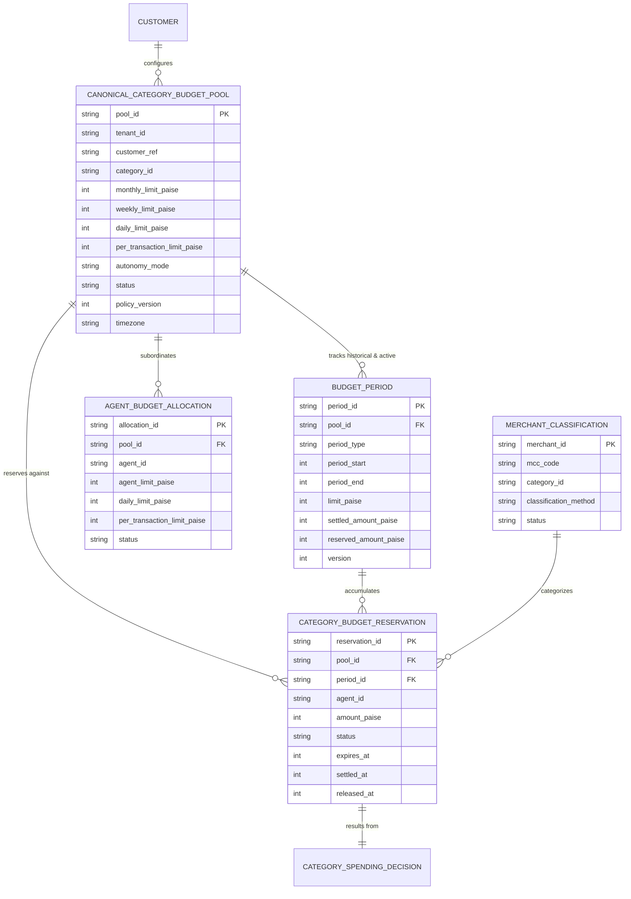
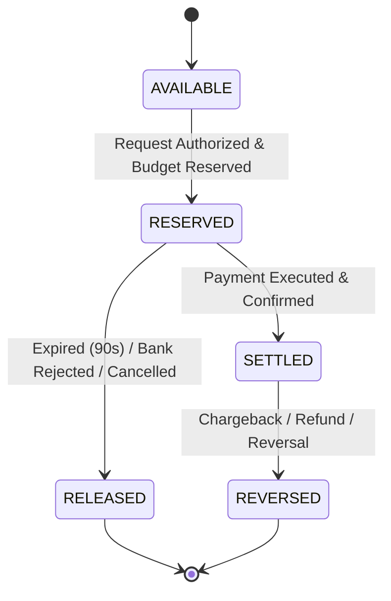

# BP-1: Advanced Category Budget Data Model & Canonical Contracts

**Product Component:** AgentShield AI — Autonomous Category Budget Engine  
**Package:** `@agentguard/core-schema` (`packages/core-schema/src/budget-pools.ts`)  
**Standard Compliance:** Non-Negotiable Rules E1 (integer paise), E2 (UTC epoch ms), I2 (hard rules / fail-closed DENY), I4 (atomic reservation lifecycle)

---

## 1. Executive Summary & Design Principles

Phase BP-1 establishes the single canonical contract layer for AgentShield's Autonomous Category Budget Engine. It addresses the architectural findings and corrections identified during Phase BP-0:
1. **Integer Paise Exclusivity (Rule E1):** All currency limits, allocations, reservations, and settlements are strictly represented as positive or non-negative 64-bit safe integers in Indian paise (`1 INR = 100 paise`). Floats are strictly rejected.
2. **Deterministic Time & Timezone Boundary (Rule E2):** All event, verification, and boundary timestamps are UTC epoch milliseconds. Billing period resets and daily/monthly limit bucketing strictly conform to standard IANA timezone identifiers (defaulting to `Asia/Kolkata` IST).
3. **Coordinated Reservation Lifecycle (Correction 1 & 3):** Replaces ambiguous database states with an unambiguous state machine:
   $$\text{AVAILABLE} \longrightarrow \text{RESERVED} \longrightarrow \text{SETTLED}$$
   Terminal alternative branches include $\text{RESERVED} \to \text{RELEASED}$ and $\text{SETTLED} \to \text{REVERSED}$.
4. **Sourced Classification Evidence (Correction 2):** LLM and advisory suggestions from Gateway or invoice text are strictly classified as `AI_ADVISORY`. Sourced payment-rail evidence (e.g. NPCI UPI ISO 18245 4-digit MCC codes) is mandatory before a classification can ever be designated as `VERIFIED`.
5. **Multi-Agent Authority Subordination (Invariant I7):** Sub-agent allocations cannot exceed the parent customer's category budget pool limits. Inverted hierarchies ($\text{per\_tx} > \text{daily}$ or $\text{daily} > \text{agent\_limit}$) fail validation.
6. **Hard Fail-Closed Evaluation (Invariant I2 & I8):** Any violation of category limits or merchant policies immediately produces `DENY` or `ASK`. A decision containing policy violations cannot emit `ALLOW`.

---

## 2. Entity Relationship Model



---

## 3. Canonical Contracts & Schemas

### 3.1 Autonomy Modes
The engine formalizes three canonical operating modes:
- `AUTO_APPROVE_WITHIN_LIMITS`: Autonomous agent spending within customer-authorized category limits without human interruption.
- `ASK_BEFORE_EVERY_PAYMENT`: All agent payment requests require human passkey confirmation regardless of amount.
- `MANUAL_ONLY`: Agent cannot initiate payments; restricted to preparing draft summaries.

```typescript
export const CanonicalAutonomyModeSchema = z.enum([
  'AUTO_APPROVE_WITHIN_LIMITS',
  'ASK_BEFORE_EVERY_PAYMENT',
  'MANUAL_ONLY'
]);

export const AutonomyModeSchema = z.union([
  CanonicalAutonomyModeSchema,
  LegacyAutonomyModeSchema
]).transform((val): CanonicalAutonomyMode => {
  if (val === 'ALWAYS_ASK') return 'ASK_BEFORE_EVERY_PAYMENT';
  if (val === 'PAY_WITHOUT_RESTRICTION') return 'AUTO_APPROVE_WITHIN_LIMITS';
  return val;
});
```

### 3.2 Canonical Category Budget Pool
Defines the authoritative budget envelope for a specific spending category:
- **Hierarchy invariant:** $\text{per\_transaction\_limit\_paise} \le \text{daily\_limit\_paise} \le \text{weekly\_limit\_paise} \le \text{monthly\_limit\_paise}$
- **Temporal invariant:** $\text{valid\_until} > \text{valid\_from}$
- **Currency invariant:** Strictly `'INR'`
- **Timezone invariant:** Validated IANA identifier (e.g. `'Asia/Kolkata'`)

### 3.3 Budget Period Model
Enforces period-bound tracking preserving historical auditability:
- Types: `DAILY`, `WEEKLY`, `MONTHLY`
- Limits invariant: $\text{settled\_amount\_paise} + \text{reserved\_amount\_paise} \le \text{limit\_paise}$
- Period invariant: $\text{period\_end} > \text{period\_start}$

### 3.4 Reservation Lifecycle State Machine



- Permitted transitions:
  - `RESERVED` $\to$ `SETTLED` (requires `settled_at` timestamp)
  - `RESERVED` $\to$ `RELEASED` (requires `released_at` timestamp)
  - `SETTLED` $\to$ `REVERSED`
- Terminal states: `RELEASED`, `REVERSED`. Re-activation of a terminal reservation is rejected.

### 3.5 Sourced Merchant Classification
Prevents prompt injection and advisory hallucinations from bypassing category boundaries:
- **MCC:** Exactly 4 numeric digits adhering to ISO 18245.
- **Classification Methods:** `PAYMENT_RAIL`, `VERIFIED_MERCHANT`, `CUSTOMER_MAPPING`, `DETERMINISTIC_RULE`, `AI_ADVISORY`.
- **Advisory Rule:** If method is `AI_ADVISORY`, the status **cannot** be marked as `VERIFIED` without external payment-rail corroboration. It must be `PROVISIONAL` or `FLAGGED`.

### 3.6 Multi-Agent Allocation
Permits multiple autonomous agents to share a single category budget pool while enforcing per-agent bounds:
- $\text{agent per\_transaction\_limit\_paise} \le \text{agent daily\_limit\_paise} \le \text{total agent\_limit\_paise}$
- Expiration cannot exceed the pool's `valid_until`.

### 3.7 Category Spending Decision
- Decision Codes: `ALLOW`, `ASK`, `DENY`, `DEFER`
- **Invariant I2 Enforcement:** If `violations.length > 0`, the decision **cannot** be `ALLOW`.

---

## 4. Canonical JSON Payload Examples

### 4.1 Canonical Category Budget Pool
```json
{
  "pool_id": "pool_shopping_001",
  "tenant_id": "tenant_enterprise_01",
  "customer_ref": "cust_98765",
  "category_id": "SHOPPING",
  "category_name": "Retail Shopping & Groceries",
  "currency": "INR",
  "monthly_limit_paise": 5000000,
  "weekly_limit_paise": 2000000,
  "daily_limit_paise": 500000,
  "per_transaction_limit_paise": 100000,
  "autonomy_mode": "AUTO_APPROVE_WITHIN_LIMITS",
  "status": "ACTIVE",
  "policy_version": 1,
  "valid_from": 1700000000000,
  "valid_until": 1735689600000,
  "timezone": "Asia/Kolkata",
  "created_at": 1700000000000,
  "updated_at": 1700000000000
}
```

### 4.2 Category Budget Reservation
```json
{
  "reservation_id": "res_8849204859",
  "pool_id": "pool_shopping_001",
  "tenant_id": "tenant_enterprise_01",
  "customer_ref": "cust_98765",
  "agent_id": "agent_procurement_99",
  "workflow_id": "wf_office_supplies_04",
  "request_id": "req_847291048",
  "idempotency_key": "idem_39028401",
  "transaction_digest": "4a5b6c7d8e9f0123456789abcdef0123456789abcdef0123456789abcdef0123",
  "category_id": "SHOPPING",
  "amount_paise": 450000,
  "currency": "INR",
  "period_id": "period_2026_11_shopping",
  "pool_policy_version": 1,
  "status": "RESERVED",
  "created_at": 1763690400000,
  "expires_at": 1763690490000
}
```

### 4.3 Sourced Merchant Classification
```json
{
  "merchant_id": "merch_reliance_retail",
  "merchant_name": "Reliance Smart Bazaar",
  "mcc_code": "5411",
  "category_id": "SHOPPING",
  "verification_source": "NPCI_UPI_RAILS",
  "verification_reference": "UPI_REF_984729103847",
  "classification_method": "PAYMENT_RAIL",
  "confidence_basis": "Settled under NPCI Grocery & Supermarket MCC",
  "verified_at": 1763690000000,
  "status": "VERIFIED"
}
```

---

## 5. Backward Compatibility & Test Coverage

All schemas in `@agentguard/core-schema` maintain full backward compatibility with the existing Next.js Cockpit (`apps/compliance-cockpit`):
- `CategoryBudgetPoolSchema` and `AutonomousPoolPolicySchema` preserve the legacy field naming conventions (`monthlyCapPaise`, `policyMode`, `ALWAYS_ASK`, etc.).
- The Jest test suite `packages/core-schema/src/budget-pools.test.ts` executes **16 comprehensive test cases**, with 100% pass rate:
  1. Valid category pool parsing
  2. Negative amount rejection (Rule E1)
  3. Floating point amount rejection (Rule E1)
  4. Non-INR currency rejection
  5. Invalid IANA timezone rejection
  6. Invalid autonomy mode rejection
  7. Inverted period boundary rejection
  8. Limit hierarchy invariant violation rejection
  9. Reservation schema lifecycle state verification
  10. Strict state machine transition validation
  11. Non-4-digit ISO 18245 MCC rejection
  12. AI advisory classification verification restriction
  13. Sub-agent allocation limit exceedance rejection
  14. Temporal validity window violation rejection
  15. Positive integer policy version enforcement
  16. Legacy autonomy mode transforms and Invariant I2 hard violation enforcement
