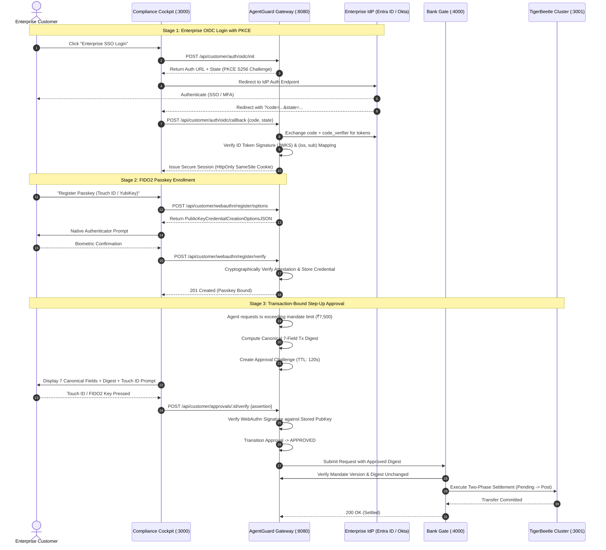

# ENTERPRISE-AUTH-ARCHITECTURE.md — Phase 7.1 Enterprise Identity & Step-Up Architecture
**Document:** `docs/ENTERPRISE-AUTH-ARCHITECTURE.md`  
**Version:** 1.0.0 (Phase 7.1 Production Checkpoint)  
**Status:** APPROVED ARCHITECTURE SPECIFICATION  
**Target Git Branch:** `feat/agentguard-banking`  

---

## 1. Executive Summary

AgentGuard AI is designed for institutional deployment in commercial banks, fintech platforms, and autonomous financial workflows. While autonomous AI agents act as delegated executors, the **root financial authority remains strictly anchored in human customer identity and institutional permissions**.

Phase 7.1 establishes the enterprise-grade identity, session, and step-up authorization infrastructure for AgentGuard AI:
1. **Provider-Neutral Enterprise OIDC**: Authorization Code Flow with PKCE (S256), cryptographic JWKS verification via `jose`, and immutable `(iss, sub)` account mapping.
2. **FIDO2 / WebAuthn Hardware Passkeys**: Multi-device biometric (Touch ID / Face ID) and hardware key (YubiKey) registration and assertion verification via `@simplewebauthn/server` and `@simplewebauthn/browser`.
3. **Transaction-Bound Customer Step-Up Approval**: Cryptographic binding of WebAuthn challenges to the exact 7-field RFC 8785 canonical transaction digest, preventing out-of-band manipulation, mandate version drift, or execution tampering.
4. **Demo Mode Hardening**: Strict fail-closed demo mode protection completely preventing development PIN authentication in production environments.

---

## 2. Authentication Boundary & Separation of Concerns

AgentGuard strictly maintains **two orthogonal, non-interchangeable security namespaces** (Rule E5):

```
┌────────────────────────────────────────────────────────────────────────┐
│                        AGENTGUARD AUTHENTICATION BOUNDARIES            │
├─────────────────────────────────────┬──────────────────────────────────┤
│        CUSTOMER IDENTITY SPACE      │       AGENT IDENTITY SPACE       │
│      (Enterprise OIDC / WebAuthn)   │       (Ed25519 Keypair / JWK)    │
├─────────────────────────────────────┼──────────────────────────────────┤
│ • Institutional OIDC (Entra/Okta)   │ • Autonomous Agent Runtime       │
│ • FIDO2 Passkeys (TouchID, YubiKey) │ • Ed25519 Request Signing        │
│ • Server-Side Sessions (HttpOnly)   │ • Ephemeral Execution Permits    │
│ • Mandate Creation & Step-Up Auth   │ • Zero Customer Session Access   │
│ • Endpoints: /api/customer/*        │ • Endpoints: /api/agent/*        │
└─────────────────────────────────────┴──────────────────────────────────┘
```

> [!IMPORTANT]
> **Rule E5 (Cross-Namespace Authentication Rejection):**
> Customer session tokens (`session_token`) presented to `/api/agent/*` endpoints are rejected with HTTP 401 `CROSS_NAMESPACE_AUTH_REJECTED`. Conversely, agent signatures or credentials presented to `/api/customer/*` endpoints are rejected immediately.

---

## 3. High-Level Architecture Diagram



---

## 4. Security Principles & Invariant Guarantees

1. **Provider-Neutral OpenID Connect (OIDC)**:
   Does not bind the enterprise to a single vendor. Microsoft Entra ID is supported as the reference implementation, while Okta, Ping Identity, Google Workspace, and self-hosted Keycloak adhere to the identical `OidcProviderConfig` specification.
2. **Stable `(iss, sub)` Identity Anchoring**:
   Customers are never indexed or granted access by raw email address. Accounts are mapped strictly to the immutable pair `(idp_issuer, idp_subject)`. If an employee changes email addresses (e.g. name change or domain migration), account ownership and mandate bindings remain unbroken.
3. **Hardware-Backed FIDO2 Step-Up**:
   Critical transactions requiring human-in-the-loop escalation are authenticated via WebAuthn Level 3 authenticators (Secure Enclave, TPM, YubiKey). Passwords, SMS OTPs, and email verification links are rejected for financial step-up authorization.
4. **Digest Binding & Mandate Version Safety (Invariants I1, I6)**:
   Customer approval is bound to the exact 7-field canonical transaction digest. Any change to the payee, amount, currency, account, or purpose invalidates the approval. Furthermore, if the customer modifies the mandate (bumping `mandate_version`) while an approval is pending, the approval is immediately invalidated (`APPROVAL_MANDATE_VERSION_MISMATCH`).
5. **Fail-Closed Production Defense**:
   Demo PIN login is blocked unconditionally in production (`NODE_ENV=production`). If `DEMO_MODE=1` is configured in production, the Gateway terminates on startup.

---

## 5. Architectural Components & Directory Map

| Component | Repository Path | Responsibility |
|:---|:---|:---|
| **Auth Schemas** | `packages/core-schema/src/banking/auth-schema.ts` | Zod contracts for OIDC, WebAuthn, and Step-Up Approvals |
| **Identity Stores** | `packages/gateway-mcp/src/db/banking-stores.ts` | SQLite tables: `customer_idp_identities`, `oidc_auth_states`, `webauthn_credentials`, `webauthn_challenges`, `transaction_bound_approvals` |
| **Enterprise OIDC** | `packages/gateway-mcp/src/services/enterprise-oidc-service.ts` | PKCE S256 generation, code exchange, `jose` JWKS cryptographic verification |
| **WebAuthn Service**| `packages/gateway-mcp/src/services/webauthn-service.ts` | FIDO2 registration & assertion verification via `@simplewebauthn/server` |
| **Step-Up Approval**| `packages/gateway-mcp/src/services/transaction-approval-service.ts` | Canonical digest binding, mandate version tracking, single-use atomic consumption |
| **Customer API**    | `packages/gateway-mcp/src/api/customer.ts` | REST endpoints for OIDC, WebAuthn, mandates, and approvals |
| **Cockpit Frontend**| `apps/compliance-cockpit/src/app/banking/page.tsx` | Next.js 14 client interface with `@simplewebauthn/browser` |
| **Security Tests**  | `packages/gateway-mcp/src/__tests__/enterprise-auth.test.ts` | Comprehensive unit & cryptographic integration test suite (19 tests) |

---
*AgentGuard AI Architecture Team — Phase 7.1 Master Specification*
