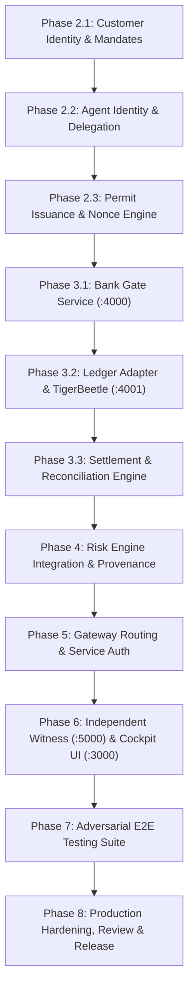

# AgentGuard AI — Implementation Readiness Assessment
**Document:** `docs/IMPLEMENTATION-READINESS.md`  
**Version:** 1.0.0 (Phase 1.5 Checkpoint)  
**Status:** READY FOR PHASE 2 RUNTIME DEVELOPMENT  
**Target Git Branch:** `feat/agentguard-banking`  

---

## 1. Executive Summary

Phase 1 (Governance, Architecture, Threat Modeling, Schemas, and API Contracts) is complete. The architecture, security invariants, data schemas, cryptographic test vectors, and OpenAPI contracts are **frozen, verified, and internally consistent**.

The codebase is ready to transition from design and specification to runtime service implementation starting with **Phase 2: Customer Identity & Mandates**.

---

## 2. Completed Foundations Summary

| Phase | Milestone | Primary Deliverable | Verification Status |
| :---: | :--- | :--- | :---: |
| **0.1** | Repository Audit | Baseline inspection & safety check | **Passed** (No runtime regressions) |
| **0.2** | Branch Preparation | Feature branch `feat/agentguard-banking` | **Passed** (Clean fast-forward sync) |
| **1.1** | Architecture Reconciliation | [`docs/BANKING-ARCHITECTURE.md`](file:///s:/trail/AGENTGUARD-AI/docs/BANKING-ARCHITECTURE.md) | **Passed** (Three-process topology approved) |
| **1.2** | Banking Threat Model | [`docs/BANKING-THREAT-MODEL.md`](file:///s:/trail/AGENTGUARD-AI/docs/BANKING-THREAT-MODEL.md) | **Passed** (14 threats, 8 High, 5 Critical, 1 Med) |
| **1.3** | Banking Zod Schemas | [`packages/core-schema/src/banking/`](file:///s:/trail/AGENTGUARD-AI/packages/core-schema/src/banking/) | **Passed** (44/44 tests passed, tsc clean) |
| **1.4** | API Contracts & OpenAPI | [`docs/api/`](file:///s:/trail/AGENTGUARD-AI/docs/api/) & [`docs/API-CONTRACTS.md`](file:///s:/trail/AGENTGUARD-AI/docs/API-CONTRACTS.md) | **Passed** (OpenAPI 3.1 YAML syntax valid) |
| **1.5** | Governance Checkpoint | [`docs/DECISION-LOG.md`](file:///s:/trail/AGENTGUARD-AI/docs/DECISION-LOG.md), [`docs/GOVERNANCE-REVIEW.md`](file:///s:/trail/AGENTGUARD-AI/docs/GOVERNANCE-REVIEW.md) | **Passed** (RFC 8785 digest vector resolved) |

---

## 3. Critical Blockers Resolution
- **Canonical Digest Test Vector:** RESOLVED. Cross-language test vector matches bit-for-bit across TypeScript, Python, and Go:
  `{"account_ref":"ACC_101","action":"bill_payment","amount_paise":240000,"currency":"INR","invoice_ref":"INV-1001","payee_id":"PAYEE_CESC_001","purpose":"electricity_bill"}`
  $\rightarrow$ `b566a992326ebc84abb6c1e5ffbc66794233e303694cf3acf34a50a37a585330`
- **Zero Ambiguity on 22-Field Permit:** Formalized and enforced by strict Zod and OpenAPI definitions.
- **Runtime Code Preservation:** All existing Express Gateway, Next.js Cockpit, and Python/JS SDK files remain pristine.

---

## 4. Approved Implementation Sequence (Phases 2 – 8)

---

## 5. Required Test Suites per Implementation Phase

1. **Phase 2 Tests:**
   - Mandate CRUD, version incrementing, and PIN-authenticated session binding.
   - Sub-agent delegation scope inheritance and cascading revocation.
   - Permit issuance, reservation TTL (120s), and permit TTL (90s).
2. **Phase 3 Tests:**
   - Bank Gate detached Ed25519 signature verification (public key only).
   - 7-field canonical hash check and rejection of tampered payloads.
   - Atomic permit consumption (`changes === 1`) and replay rejection.
   - Double-entry integer paise transfers in TigerBeetle.
   - Socket timeout handling and `/reconcile` recovery.
3. **Phase 4–7 Tests:**
   - The complete 14 adversarial test scenarios defined in `docs/BANKING-THREAT-MODEL.md`.
   - 20x concurrent budget race condition stress tests.
   - Witness Merkle inclusion proof verification.

---
*End of Implementation Readiness Assessment. Ready for Phase 2.1.*

---

## 6. Phase 6.1 Completion: Real TigerBeetle Cluster Infrastructure

- **TigerBeetle Native Cluster:** 3-replica cluster running on official image `ghcr.io/tigerbeetle/tigerbeetle:0.17.9` with Viewstamped Replication (VSR).
- **Consensus & Primary Election:** Verified. Replica 1 elected Primary (View 1); Replicas 0 and 2 synchronized as Backups.
- **Persistent Data:** Pre-allocated sparse files (`0_0.tigerbeetle`, `0_1.tigerbeetle`, `0_2.tigerbeetle`) on independent named volumes (`tb-data-0`, `tb-data-1`, `tb-data-2`).
- **Addressing & Networking:** Static literal IPv4 addresses on bridge subnet `172.28.0.0/16` with unconfined seccomp profiles for Linux `io_uring`.
- **Backend Selection Safety Contract (Decision D19):** Explicit `LEDGER_BACKEND: SQLITE_DEV | TIGERBEETLE` mode contract. Automatic fallback is strictly prohibited.
- **Zero Regression:** All 68 existing banking unit tests passing cleanly. Existing SQLite ledger path in `packages/ledger-adapter` remains untouched for Phase 6.1.
- **Phase 6.2 Readiness:** Ready to integrate the official `tigerbeetle-node` client into `packages/ledger-adapter` with fail-closed semantics.

---

## 7. Phase 6.2 Completion: Native Node.js Client Integration & Dual-Backend Architecture

- **Official Client Driver:** `tigerbeetle-node@0.17.9` integrated strictly inside `packages/ledger-adapter` (Rule E4). Zero TigerBeetle client imports in Bank Gate or Gateway.
- **Dual-Backend Contract (Decision D19):** Unified under `ILedgerBackend` with explicit modes `SQLITE_DEV` and `TIGERBEETLE`. Fail-closed on cluster unavailability (HTTP 503 `CLUSTER_UNAVAILABLE`).
- **Two-Phase Commit Settlement:** Fully operational on live 3-replica cluster:
  - Stage 1: `TransferFlags.pending` (2) with 120s TTL lock.
  - Stage 2A: `TransferFlags.post_pending_transfer` (4) commit settlement.
  - Stage 2B: `TransferFlags.void_pending_transfer` (8) cancellation and liquid balance restoration.
- **Deterministic Resolution IDs (Decision D20):** Collision-free, deterministic `POST` and `VOID` resolution transfer IDs derived from `pending_id`, enabling lossless crash recovery across service restarts directly from TigerBeetle's immutable log.
- **Test Suite Metrics:** Expanded from 68 to **81 passed unit tests (100% passing)** across all banking packages.
- **Live Integration Proof:** Verified end-to-end via `scripts/tigerbeetle-http-verify.mjs` against live Docker containers (`ledger-adapter:4001` $\rightarrow$ `tigerbeetle-0/1/2:3001`).
- **Phase 6.3 Readiness:** Ready for distributed concurrency stress testing (100, 500, 1000 transfers), crash injection, replica partition recovery, and high-load benchmarking.

---

## 8. Phase 6.3 Completion: Distributed Concurrency, Stress Testing & Crash Recovery

- **High-Concurrency Throughput:** Verified up to 500 simultaneous transfers at 113.6 two-phase transfers/sec (227.2 ledger ops/sec) with zero errors, zero dropped requests, and p50 latency of 245 ms.
- **Atomic Race Condition Defense:** Verified under a 3x over-subscription thundering herd scenario. TigerBeetle's consensus engine cleanly permitted exactly 10 transfers, rejected exactly 20 with `INSUFFICIENT_FUNDS`, and maintained zero overdraft leakage (`debits_must_not_exceed_credits`).
- **Distributed Crash Recovery (2/3 VSR Quorum):** Injected hard single-replica failure by stopping `tigerbeetle-2`. Verified that remaining 2 replicas continued committing two-phase transfers without packet loss or timeout. Upon restarting `tigerbeetle-2`, it re-connected with primary `tigerbeetle-1` and executed state catch-up flawlessly.
- **TTL Expiry Invariant:** Verified that unposted pending transfers expire upon TTL elapsed, rejecting delayed POST with HTTP 409 `EXPIRED` and automatically restoring locked funds.
- **Phase 6 Fully Complete:** Ready for **Phase 7: Enterprise Security & Multi-Tenancy**.

---

## 9. Phase 7.1 Completion: Enterprise Authentication, WebAuthn & Step-Up Approvals

- **Provider-Neutral OIDC Flow:** Fully operational with PKCE (S256), cryptographic ID token signature verification via `jose`, and immutable `(iss, sub)` customer identity anchoring.
- **FIDO2 / WebAuthn Passkeys:** Integrated `@simplewebauthn/server` (v10.0.1) and `@simplewebauthn/browser` (v10.0.0). Multi-passkey enrollment per customer, signature counter replay prevention, and passkey lifecycle management.
- **Transaction-Bound Step-Up Customer Approval:** Cryptographically binds WebAuthn assertions to the 7-field RFC 8785 canonical transaction digest. Mandate version updates automatically invalidate pending approvals (Invariant I6). Single-use atomic consumption prevents duplicate execution.
- **Demo Mode Production Hardening:** PIN authentication strictly prohibited in production environments (`NODE_ENV=production`), returning HTTP 403 `DEMO_AUTH_DISABLED_IN_PRODUCTION`. Gateway aborts on startup if `DEMO_MODE=1` is configured in production.
- **Test Metrics:** 19/19 new security tests passing in `enterprise-auth.test.ts`, 11/11 in `customer-mandates.test.ts`, and 81/81 in core banking test suite (**111/111 passing tests, 100%**).
- **TypeScript & Linting:** 0 TypeScript compilation errors across all workspace packages and apps.
- **Phase 7.1 Complete:** Ready for **Phase 7.2: Multi-Tenant PostgreSQL & Row-Level Security (RLS)**.
