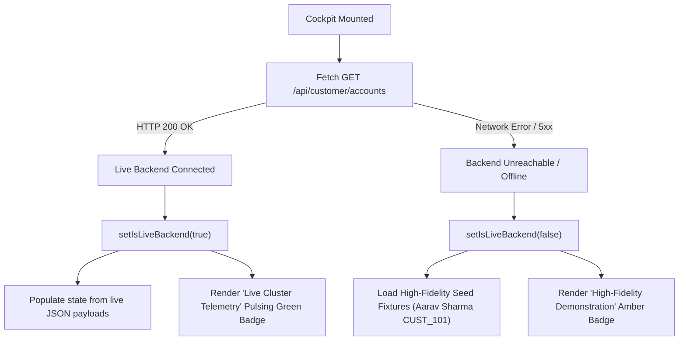

# PHASE-7.1.1-API-INTEGRATION.md — Compliance Cockpit API Integration & Live vs. Demo State Mapping
**Document:** `docs/PHASE-7.1.1-API-INTEGRATION.md`  
**Version:** 1.0.0 (Phase 7.1.1 Telemetry Contract)  
**Status:** PRODUCTION INTEGRATION SPECIFICATION  
**Target Git Branch:** `main` (tracked at `Sumeet1249/ai-trail.git`)  

---

## 1. Executive Summary

A critical requirement of Phase 7.1.1 is ensuring that the **Compliance Cockpit clearly distinguishes between live backend data and demonstration fixture data**.

The UI must never present mock values or simulated fixtures as live bank telemetry. If the Gateway, Bank Gate, Ledger Adapter, or TigerBeetle cluster is unreachable, the dashboard explicitly flags the interface as **High-Fidelity Demonstration** mode.

---

## 2. Backend Endpoint Contracts & Integration Map

The Cockpit integrates with the following Gateway (`:8080`) and Bank Gate (`:4000`) endpoints:

| Endpoint | Method | Response Payload | Frontend Integration Component |
|:---|:---:|:---|:---|
| `/api/customer/accounts` | `GET` | `{ customer_ref, accounts: [{ account_ref, balance_paise, currency, status }] }` | Header metric cards (Liquid balance in integer paise) |
| `/api/customer/mandates` | `GET` | `{ customer_ref, mandates: CustomerMandate[] }` | Mandate Matrix Tab |
| `/api/customer/webauthn/credentials` | `GET` | `{ customer_ref, credentials: WebAuthnCredentialRow[] }` | Passkeys (FIDO2) Tab |
| `/api/customer/webauthn/register/options` | `POST` | `PublicKeyCredentialCreationOptionsJSON` | Passkey Registration Modal (`startRegistration`) |
| `/api/customer/webauthn/register/verify` | `POST` | `{ message, credential_id, name }` | Passkey Verification Handler |
| `/api/customer/approvals/:id` | `GET` | `TransactionBoundApprovalRow` | Transaction-Bound Step-Up Card |
| `/api/customer/approvals/:id/verify` | `POST` | `TransactionApprovalVerifyResponse` | WebAuthn Step-Up Assertion (`startAuthentication`) |

---

## 3. Live vs. Demonstration State Transitions

The state detection logic is implemented in `apps/compliance-cockpit/src/app/banking/page.tsx`:

### Visual Differentiation
- **Live Connected Mode**:
  - Top Badge: `bg-emerald-500/10 text-emerald-400 border-emerald-500/20` with a pulsing green indicator.
  - 3D Topology Overlay: Displays `Live Cluster Telemetry`.
  - Node Status: Dynamic health probes against running container ports.
- **Demonstration Fixture Mode**:
  - Top Badge: `bg-amber-500/10 text-amber-400 border-amber-500/20` with solid amber indicator.
  - 3D Topology Overlay: Displays `High-Fidelity Demonstration`.
  - All accounts and mandates are explicitly seeded from frozen test fixtures (`CUST_101`, `MND_ELEC_101`, `ACC_101`).

---

## 4. Error Handling & Resilience Semantics

1. **Graceful WebAuthn Fallback**:
   If the browser does not support WebAuthn or the user cancels the hardware biometric prompt, the UI intercepts the error, sets `stepUpStatus` with the exact browser failure message, and leaves the approval in `PENDING` state rather than crashing or freezing.
2. **WebGL Context Loss**:
   If the graphics driver drops WebGL context, `Security3DTopology` automatically activates the 2D Schematic Grid, ensuring financial approvals and mandate operations remain 100% accessible.
3. **No Float Leakage**:
   All monetary amounts received from the API are stored as integer paise in component state (`liquid_paise`, `reserved_paise`, `amount_paise`). Conversion to rupees is performed strictly at render time via `formatPaise(paise: number)` using `toLocaleString('en-IN')`.

---
*AgentGuard AI Integration Engineering — Phase 7.1.1 API Specification*
