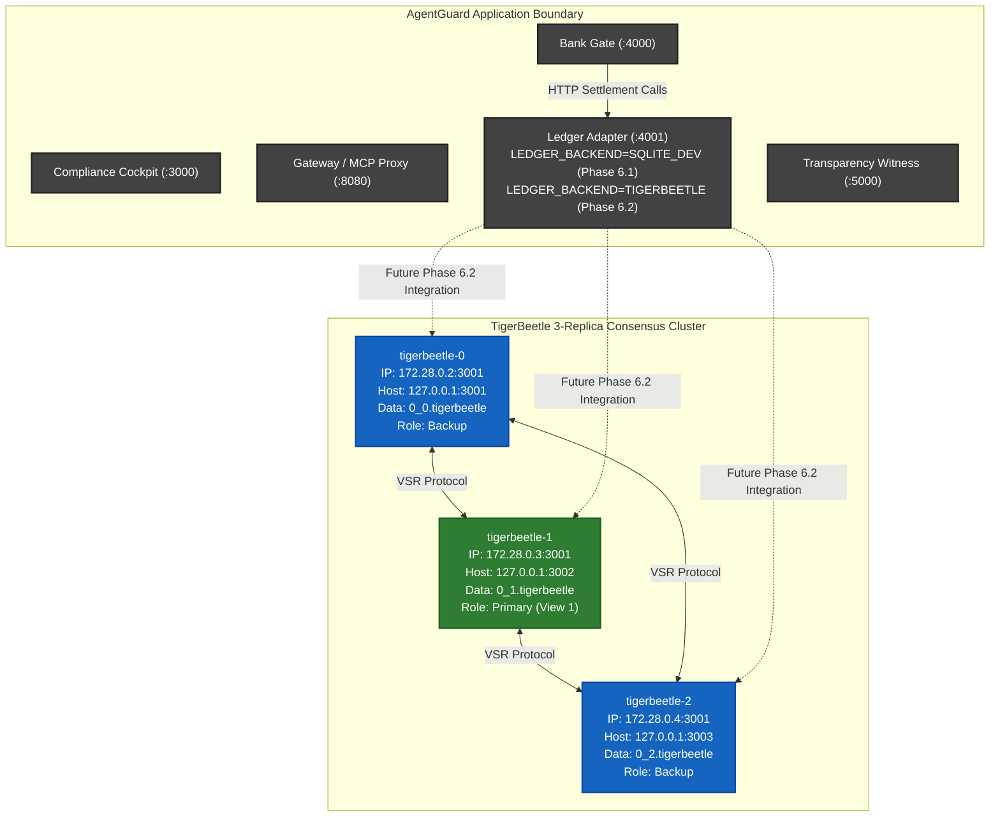
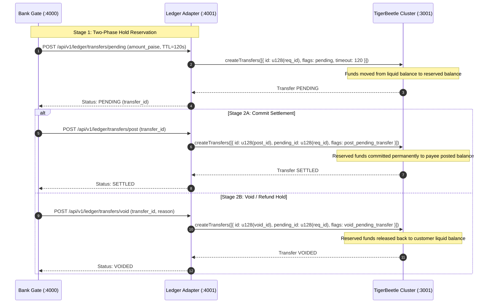

# AgentGuard AI — TigerBeetle Cluster Architecture & Backend Selection Contract

**Status:** Approved Architectural Baseline (Phase 6.1)  
**Cluster ID:** `0` (Development/Testing) | 128-bit unsigned integer  
**Replicas:** 3 (`tigerbeetle-0`, `tigerbeetle-1`, `tigerbeetle-2`)  
**Consensus Protocol:** Viewstamped Replication (VSR) with Paxos-like State Machine Replication  
**Client API:** Official `tigerbeetle-node@0.17.9` (Port 3001)  

---

## 1. Executive Summary & Core Architectural Contract

Phase 6 introduces actual distributed financial ledger infrastructure into AgentGuard AI via a 3-replica **TigerBeetle** cluster. TigerBeetle is a purpose-built, distributed financial accounting database designed to process thousands of financial transactions per second with strict double-entry balance tracking and Viewstamped Replication (VSR) consensus.

### 1.1 Non-Negotiable Backend-Selection Safety Contract

In financial systems, silent failover between disjoint ledgers is catastrophic. If a service silently falls back from a distributed cluster to a local SQLite file during a network outage, balances, transaction sequences, and double-entry invariants will diverge permanently.

AgentGuard AI enforces the following **Backend Selection Safety Rules**:
1. **Explicit Selection Only:** The Ledger Adapter must be explicitly configured via `LEDGER_BACKEND: TIGERBEETLE` or `LEDGER_BACKEND: SQLITE_DEV`.
2. **Fail-Closed in Production:** When configured with `TIGERBEETLE`, any inability to connect to quorum must immediately return readiness failure and reject transactions with `LEDGER_UNAVAILABLE`. Under no circumstances will transactions automatically route to SQLite.
3. **Audit-Isolated Development Mode:** `SQLITE_DEV` is strictly a development and isolated unit-testing mode. Production runtimes must reject startup if `LEDGER_BACKEND=SQLITE_DEV`.
4. **No Cross-Ledger Re-try:** If an operation times out on TigerBeetle, reconciliation must query TigerBeetle directly using the deterministic UUIDv4 $\to$ u128 transfer ID. It must never attempt to "retry" the same transaction on a different backend.

---

## 2. Cluster Topology & Network Architecture

### 2.1 Cluster Specifications

| Parameter | Configuration Value | Architectural Rationale |
| :--- | :--- | :--- |
| **Container Image** | `ghcr.io/tigerbeetle/tigerbeetle:0.17.9` | Official, audited release from TigerBeetle maintainers. |
| **Cluster ID** | `0` | Reserved by TigerBeetle for testing/benchmarking; 128-bit integer in production. |
| **Replica Count** | `3` | Minimum quorum size for Byzantine fault tolerance / Paxos-like Viewstamped Replication ($2F + 1 = 3$, tolerates 1 node failure). |
| **Replica Addresses** | `172.28.0.2:3001,172.28.0.3:3001,172.28.0.4:3001` | Literal IPv4 addresses required by TigerBeetle (DNS names are rejected). |
| **Data Files** | `0_0.tigerbeetle`, `0_1.tigerbeetle`, `0_2.tigerbeetle` | Separate pre-allocated sparse data files (1.06 GiB initial sparse allocation). |
| **Persistent Volumes** | `tb-data-0`, `tb-data-1`, `tb-data-2` | Independent Docker volumes ensuring zero cross-contamination. |
| **Host Port Mappings** | `3001:3001`, `3002:3001`, `3003:3001` | Allows external inspection, diagnostics, and SDK connectivity. |

---

## 3. Empirical Discoveries & Platform Constraints

During actual container deployment on Docker Desktop / Windows (WSL 2 backend), four critical platform realities were identified:

### 3.1 Strict IPv4 Literal Addressing
- **Finding:** TigerBeetle's address parser categorically rejects container DNS hostnames (`tigerbeetle-0:3001` throws `error: --addresses: invalid IPv4 or IPv6 address`).
- **Resolution:** A dedicated bridge network `agentguard-net` is configured with subnet `172.28.0.0/16`. Static IP assignments (`172.28.0.2`, `172.28.0.3`, `172.28.0.4`) are defined in `docker-compose.yml`.

### 3.2 Linux `io_uring` and Docker Seccomp Profile
- **Finding:** TigerBeetle uses Linux `io_uring` for asynchronous zero-copy disk I/O. Docker's default security profile on Windows/WSL blocks `io_uring` syscalls, resulting in `error(io): io_uring is not available: PermissionDenied`.
- **Resolution:** All TigerBeetle replica containers and client containers must specify `security_opt: ["seccomp:unconfined"]`.

### 3.3 Scratch / Distroless Container Image
- **Finding:** `ghcr.io/tigerbeetle/tigerbeetle` is a scratch distroless image containing only `tini` and `/tigerbeetle`. It has no `/bin/sh` or `/bin/bash`.
- **Resolution:** Startup scripts must not attempt shell wrapping inside the container. File formatting is executed via dedicated, idempotent external scripts (`scripts/tigerbeetle-init.ps1` and `scripts/tigerbeetle-init.sh`).

### 3.4 Direct I/O and the `--development` Flag
- **Finding:** Virtualized Docker filesystems (such as 9P or WSL 2 virtual disks) do not support `O_DIRECT` block access required by TigerBeetle production storage engines.
- **Resolution:** Containers must pass the official `--development` flag during format and start, enabling buffered I/O compatibility while maintaining protocol accuracy.

---

## 4. Single-Host Development vs Enterprise Production Topology

> [!WARNING]
> Running 3 TigerBeetle replicas on one physical computer (or one Docker engine) provides protocol, replication, and concurrency verification. **It does NOT constitute three independent hardware failure domains.**

| Dimension | Development / Local Cluster (Phase 6.1) | Production Enterprise Cluster (Target Architecture) |
| :--- | :--- | :--- |
| **Nodes** | 3 Docker containers on 1 host | 3 dedicated Bare-Metal servers or isolated VMs |
| **Availability Zones** | Single host (Docker Desktop bridge) | 3 distinct Availability Zones (e.g. `ap-south-1a`, `1b`, `1c`) |
| **Storage Engine** | Virtual disk with `--development` | Direct NVMe raw block device with `O_DIRECT` |
| **Failure Domain** | Shared CPU, RAM, kernel, power | Independent power, cooling, network switch, OS |
| **Cluster ID** | `0` | Cryptographically random 128-bit unsigned integer |

---

## 5. Two-Phase Financial Transfer Lifecycle

When Phase 6.2 integrates the Node.js client (`tigerbeetle-node@0.17.9`), financial execution maps directly to TigerBeetle's two-phase commit protocol:

---

## 6. Phase 6.1 Readiness Checklist

- [x] Official TigerBeetle image (`0.17.9`) pulled and running.
- [x] 3 replicas (`tigerbeetle-0`, `1`, `2`) forming VSR consensus (`view=1 primary`).
- [x] Independent persistent volumes (`tb-data-0`, `tb-data-1`, `tb-data-2`).
- [x] Static IP bridge networking (`172.28.0.0/16`) resolving IPv4 literal address requirements.
- [x] Idempotent formatting scripts (`scripts/tigerbeetle-init.ps1` and `.sh`) created.
- [x] Unconfined seccomp profile configured for `io_uring` support.
- [x] Harmless test account operation verified with `tigerbeetle-node` on test ledger 999.
- [x] Zero financial data mutation and zero change to existing SQLite Ledger Adapter path.
- [x] 68/68 existing banking unit tests passing without regression.
