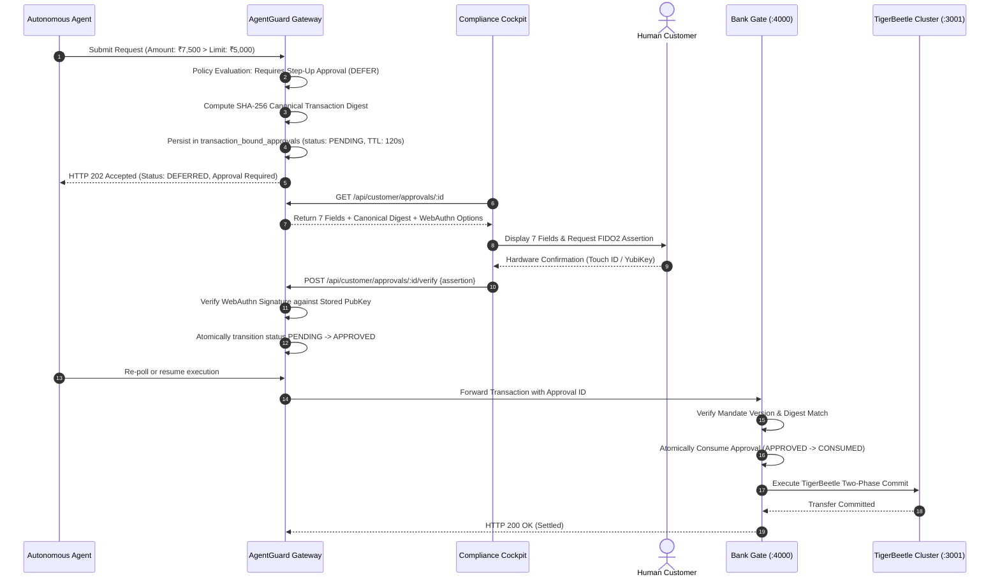

# TRANSACTION-BOUND-APPROVAL.md — Transaction-Bound Customer Step-Up Approval Specification
**Document:** `docs/TRANSACTION-BOUND-APPROVAL.md`  
**Version:** 1.0.0 (Phase 7.1 Production Standard)  
**Status:** SPECIFICATION & CRYPTOGRAPHIC CONTRACT  
**Target Git Branch:** `feat/agentguard-banking`  

---

## 1. Executive Summary

Autonomous AI agents executing delegated financial tasks frequently encounter high-risk transactions:
- Payments exceeding standard single-transaction limits (e.g. bill payment of ₹7,500 against a ₹5,000 mandate limit).
- Novel payees outside pre-approved whitelists.
- High-velocity anomalous bursts identified by the Policy Engine or Anomaly Detector.

Under AgentGuard AI, **autonomous execution cannot silently proceed without explicit customer step-up authorization**. 

Crucially, standard human-in-the-loop prompts (e.g. clicking "Approve" in a web UI or receiving a generic authenticator prompt) do not guarantee that the customer understood or approved the specific transaction details. **Phase 7.1 binds the customer's WebAuthn cryptographic assertion directly to the exact 7-field RFC 8785 canonical transaction digest**.

---

## 2. The 7 Canonical Transaction Fields

In accordance with Decision D14 and `packages/core-schema/src/banking/transaction.ts`, the canonical transaction payload consists of exactly seven lexicographically sorted fields:

```typescript
export interface CanonicalTransaction {
  account_ref: string;       // 1. Debited account reference (e.g. "ACC_101")
  action: string;            // 2. Action type (e.g. "bill_payment")
  amount_paise: number;      // 3. Strict integer paise (e.g. 750000 = ₹7,500.00)
  currency: string;          // 4. ISO 4217 currency code (e.g. "INR")
  invoice_ref: string;       // 5. Vendor invoice / bill identifier
  payee_id: string;          // 6. Beneficiary identifier (e.g. "PAYEE_POWER_001")
  purpose: string;           // 7. Human-readable purpose string
}
```

### Canonical Digest Computation
```typescript
import { computeCanonicalTransactionDigest } from '@agentguard/core-schema';

const digest = computeCanonicalTransactionDigest(transaction);
// Returns 64-character lowercase hexadecimal SHA-256 string
```

---

## 3. Cryptographic Binding Lifecycle



---

## 4. Invariant Enforcement

### Invariant I1 (Mandate Boundedness)
A customer approval cannot be manufactured by an agent. The approval record must be initiated by an authenticated customer session and verified by a valid FIDO2 credential linked to `customer_ref`.

### Invariant I6 (Mandate Version Safety)
Every approval challenge records `mandate_version` at the time of creation:
```typescript
// At execution time:
const currentMandate = stores.getMandate(approval.mandate_id);
if (currentMandate.mandate_version !== approval.mandate_version) {
  throw new Error('APPROVAL_MANDATE_VERSION_MISMATCH');
}
```
If the customer updates the mandate (changing spending limits or revoking payees), the mandate version increments ($v \to v+1$), immediately invalidating any pending or unconsumed approvals.

### Digest Integrity Invariant
Before consuming an approval for execution, Bank Gate verifies:
$$\text{approval}.\text{canonical\_tx\_digest} == \text{computeCanonicalTransactionDigest}(\text{tx})$$
If an attacker modifies the payee ID, debited account, purpose, invoice reference, or amount by even 1 paisa, the digest check fails and execution is aborted (`TRANSACTION_DIGEST_MISMATCH`).

### Single-Use Atomic Consumption
An approval cannot be replayed. The state transition from `APPROVED` to `CONSUMED` is executed as an atomic SQL update conditioned on `status = 'APPROVED'` and `expires_at > now`. A second attempt returns `false` and is rejected with `APPROVAL_ALREADY_CONSUMED`.

---

## 5. REST API Endpoints

### 5.1 `POST /api/customer/approvals/challenge`
Initiates a transaction-bound approval challenge.
- **Request Body**:
  ```json
  {
    "request_id": "3fa85f64-5717-4562-b3fc-2c963f66afa6",
    "permit_id": "PERMIT-771",
    "account_ref": "ACC_101",
    "mandate_id": "MND_ELEC_101",
    "mandate_version": 1,
    "transaction": {
      "account_ref": "ACC_101",
      "action": "bill_payment",
      "amount_paise": 750000,
      "currency": "INR",
      "invoice_ref": "INV-2026-POWER-001",
      "payee_id": "PAYEE_POWER_001",
      "purpose": "electricity_bill"
    },
    "ttl_seconds": 120
  }
  ```
- **Response (201 Created)**:
  ```json
  {
    "approval_id": "appr-7f9a-4c21-b089-22a45e99c1d1",
    "request_id": "3fa85f64-5717-4562-b3fc-2c963f66afa6",
    "canonical_tx_digest": "9e41b2c58e57f201ae877b036987f4c5208945a0bce13388a101239856adfa09",
    "webauthn_options": { /* PublicKeyCredentialRequestOptionsJSON */ },
    "expires_at": 1774000120000
  }
  ```

### 5.2 `POST /api/customer/approvals/:approvalId/verify`
Submits the customer's WebAuthn assertion response for cryptographic verification.
- **Response (200 OK)**:
  ```json
  {
    "approval_id": "appr-7f9a-4c21-b089-22a45e99c1d1",
    "request_id": "3fa85f64-5717-4562-b3fc-2c963f66afa6",
    "status": "APPROVED",
    "canonical_tx_digest": "9e41b2c58e57f201ae877b036987f4c5208945a0bce13388a101239856adfa09",
    "mandate_version": 1,
    "verified_at": 1774000015000
  }
  ```

---
*AgentGuard AI Protocol Engineering — Step-Up Security Contract*
