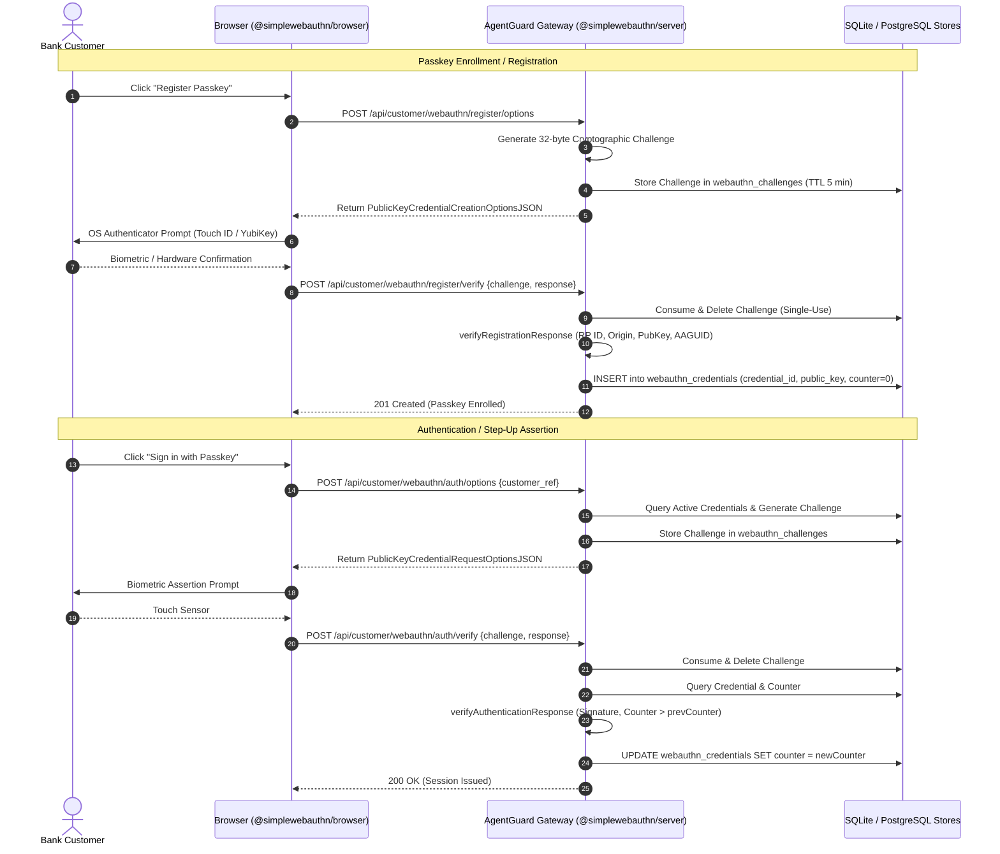

# WEBAUTHN-IMPLEMENTATION.md — FIDO2 WebAuthn Passkeys Implementation Specification
**Document:** `docs/WEBAUTHN-IMPLEMENTATION.md`  
**Version:** 1.0.0 (Phase 7.1 Production Standard)  
**Status:** SPECIFICATION & IMPLEMENTATION GUIDE  
**Target Git Branch:** `feat/agentguard-banking`  

---

## 1. Executive Summary

AgentGuard AI adopts **FIDO2 / WebAuthn passkeys** as the primary hardware-backed authentication and transaction-bound step-up mechanism for institutional banking customers.

By utilizing `@simplewebauthn/server` (v10.0.1) on the Gateway and `@simplewebauthn/browser` (v10.0.0) on the Compliance Cockpit, AgentGuard replaces shared secrets (passwords, PINs, SMS OTPs) with public-key cryptography backed by hardware authenticators (Apple Touch ID / Face ID, Windows Hello, and USB/NFC YubiKeys).

---

## 2. WebAuthn Architectural Flow



---

## 3. Database Schema

WebAuthn credentials and ephemeral challenges are stored in two dedicated tables in `BankingStores`:

### 3.1 `webauthn_credentials`
Stores persistent public keys and signature counters for registered authenticators.

```sql
CREATE TABLE IF NOT EXISTS webauthn_credentials (
  credential_id TEXT PRIMARY KEY,
  customer_ref TEXT NOT NULL,
  public_key TEXT NOT NULL,           -- Base64URL-encoded SPKI public key
  counter INTEGER NOT NULL DEFAULT 0,  -- FIDO2 signature counter (replay protection)
  transports TEXT,                    -- JSON array: ["internal", "usb", "nfc"]
  aaguid TEXT,                        -- Authenticator Attestation GUID
  name TEXT NOT NULL,                 -- User-friendly nickname (e.g. "Work MacBook")
  created_at INTEGER NOT NULL,
  last_used_at INTEGER,
  revoked_at INTEGER,                 -- NULL if active; timestamp if revoked
  FOREIGN KEY (customer_ref) REFERENCES customers(customer_ref)
);
CREATE INDEX IF NOT EXISTS idx_webauthn_customer ON webauthn_credentials(customer_ref);
```

### 3.2 `webauthn_challenges`
Maintains ephemeral challenges enforcing strict single-use consumption.

```sql
CREATE TABLE IF NOT EXISTS webauthn_challenges (
  challenge TEXT PRIMARY KEY,
  customer_ref TEXT NOT NULL,
  challenge_type TEXT NOT NULL,       -- 'REGISTRATION' | 'AUTHENTICATION' | 'TRANSACTION_APPROVAL'
  context_json TEXT NOT NULL,         -- Ephemeral parameters (e.g. approval_id)
  expires_at INTEGER NOT NULL,        -- Epoch ms
  created_at INTEGER NOT NULL
);
CREATE INDEX IF NOT EXISTS idx_webauthn_challenges_exp ON webauthn_challenges(expires_at);
```

---

## 4. Replay Protection & Counter Management

In accordance with Section 7.2 of the W3C WebAuthn Level 3 specification:
1. Every authenticator response returns an incrementing 32-bit unsigned `counter`.
2. When verifying an authentication assertion:
   - If `new_counter > stored_counter`: Signature is valid, and the stored counter is updated to `new_counter`.
   - If `new_counter <= stored_counter` (and `stored_counter > 0`): The authenticator signature is **rejected as a cloned device or replay attack**.
3. Challenges are atomically fetched and deleted via `consumeWebAuthnChallenge` upon the first verification attempt. Expired challenges (> 300 seconds) return null and are rejected.

---

## 5. Multi-Device Management REST API

| Method | Endpoint | Description |
|:---|:---|:---|
| `POST` | `/api/customer/webauthn/register/options` | Generates FIDO2 registration options. |
| `POST` | `/api/customer/webauthn/register/verify` | Cryptographically verifies attestation and stores public key. |
| `POST` | `/api/customer/webauthn/auth/options` | Generates authentication challenge for customer's passkeys. |
| `POST` | `/api/customer/webauthn/auth/verify` | Cryptographically verifies assertion signature and issues session. |
| `GET` | `/api/customer/webauthn/credentials` | Lists customer's active passkeys with nicknames and last used dates. |
| `PATCH`| `/api/customer/webauthn/credentials/:id` | Renames a passkey nickname. |
| `POST` | `/api/customer/webauthn/credentials/:id/revoke` | Revokes a passkey, preventing future authentication or approvals. |

---

## 6. Implementation Security Rules

- **Zero Client-Side Verification Trust**: A client request containing `webauthn_verified: true` is treated as unauthenticated. Verification occurs strictly on the Gateway server by importing `@simplewebauthn/server`'s `verifyAuthenticationResponse`.
- **RP ID Matching**: The Relying Party ID (`rpId`) is verified strictly against the host origin (`localhost`, internal bank domain).
- **User Verification**: `userVerification: 'preferred'` or `'required'` is enforced, mandating biometric or PIN interaction on the local authenticator.

---
*AgentGuard AI Security Engineering — FIDO2 / WebAuthn Specification*
