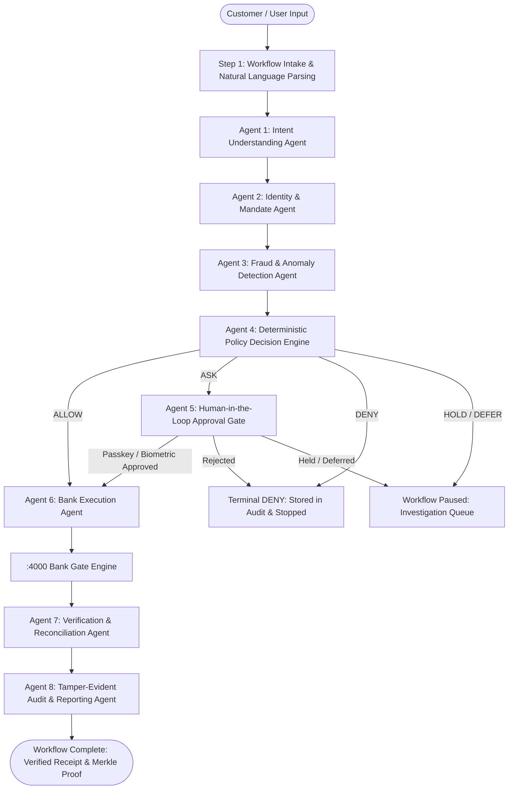

# AgentShield — Workflow Orchestration Architecture & System Audit

**Audit Date**: November 2026  
**Target Environment**: `http://localhost:13003/banking`  
**Security Governance Invariants**: I1–I9, Engineering Rules E1–E8  
**Scope**: Transitioning from a purely reactive banking guard to an **End-to-End Autonomous Banking Workflow & Multi-Agent Orchestration Platform** with deterministic human-in-the-loop controls.

---

## 1. System Inventory & Component Audit

| Component | Port / Path | State | Verification Status | Integration Role in Workflow Pipeline |
| :--- | :--- | :--- | :--- | :--- |
| **Gateway MCP** | `http://localhost:8081` | Running (Task 206) | Real & Functional | Pre-execution proxy, Intent-Drift detection, Rule evaluation. |
| **Bank Gate** | `http://localhost:4000` | Running (Task 268) | Real & Functional | Ed25519 single-use TBP verification, 7-field digest check, Atomic permit consumption. |
| **Independent Witness** | `http://localhost:5000` | Running (Task 272) | Real & Functional | SHA-256 Merkle hash chain co-signing, non-repudiation audit trail. |
| **Compliance Cockpit** | `http://localhost:13003` | Running (Task 276) | Real & Functional | Next.js 14 frontend, 3D topology, Approvals UI, Attack Lab simulator. |
| **Ledger Adapter** | In-tree package | Static tests pass | Real & Isolated | Two-phase commitment (`RESERVED -> COMMITTED`), integer paise balance checks. |

### Data Authenticity Audit:
- **Real Backend Paths**: Live trace logging (`/api/gateway/traces`), policy violation evaluation, detached Ed25519 cryptographic signing (`node:crypto`), Merkle tree hashing.
- **Simulated/Seeded Elements**: High-volume telemetry counters (e.g. 12,345 threats, 516 mock traces) are currently driven by `apps/compliance-cockpit/src/lib/mock-traces.ts`.
- **Target Upgrade**: Wire real workflow execution events into Cockpit telemetry so counters represent genuine executed/blocked orchestrations.

---

## 2. End-to-End Autonomous Multi-Agent Pipeline

To transform Banking Command into a live, observable, semi-autonomous operations platform, transactions follow an **8-Stage Sequential Agent Workflow**:

---

## 3. Four Deterministic Decision States

Following banking security standards and **Rule E1 / Invariants I1–I9**:

1. **ALLOW (Autonomous Handoff)**:
   - Low-risk, fully in-mandate actions (e.g., balance inquiry, utility payment $\le ₹2,000$ to whitelisted payee).
   - Automatically hands off to the next agent in milliseconds without manual friction.
2. **ASK (Human Step-Up Required)**:
   - In-scope, high-value transfers (e.g., $> ₹10,000$), unverified invoices, or velocity spikes.
   - Pauses the execution agent. Dispatches WebAuthn/Passkey push notification to `/approvals`.
3. **DENY (Final & Immutable)**:
   - Signature mismatch, revoked mandate, unregistered offshore payee, or hard budget overruns.
   - **Non-negotiable Invariant I2**: An AI agent can NEVER approve or override a hard DENY.
4. **DEFER / HOLD (Pause & Investigate)**:
   - Unreachable core banking gateway, ambiguous OCR invoice text, or network partitioning.
   - State persists safely in SQLite without duplicate ledger execution.

---

## 4. UI Architecture & The 3-Panel Workflow Studio

In alignment with your uploaded design references (*SentralQ, AI Agent Control Plane, Ctrl.ai*), the `/banking` view is structured into three connected zones:

1. **Top: Interactive Visual Agent Map**:
   - Visual nodes depicting each specialized agent connected by glowing dependency rays.
   - Real-time pulse states: `Green = Completed`, `Blue = Running`, `Amber = Awaiting Approval`, `Red = Blocked`.
2. **Middle: Live Workflow Intake & Execution Timeline**:
   - Natural language input: *"Pay my electricity bill of ₹2,450 to my registered provider"*.
   - Structured parameters extracted into immutable fields: Customer, Payee, Amount (Paise), Mandate ID, Idempotency Key.
   - Action controls: `[Accept]`, `[Deny]`, `[Hold]`.
3. **Bottom: Deep Telemetry & Inspection Drawer**:
   - Selected agent's internal reasoning, rule IDs fired, latency in ms, payload digest, and detached Ed25519 cryptographic signatures.

---

## 5. Implementation Roadmap (Zero-Breaking Policy)

- **Phase 1**: Persist this Audit (`docs/WORKFLOW-ORCHESTRATION-AUDIT.md`) and define shared TypeScript schemas for the 8 workflow states.
- **Phase 2**: Implement the Workflow State Machine in `packages/core-schema` and `packages/gateway-mcp`.
- **Phase 3**: Upgrade `apps/compliance-cockpit/src/components/banking/attack-lab-view.tsx` with the 3-panel autonomous studio while keeping the 7 attack scenarios fully testable.
