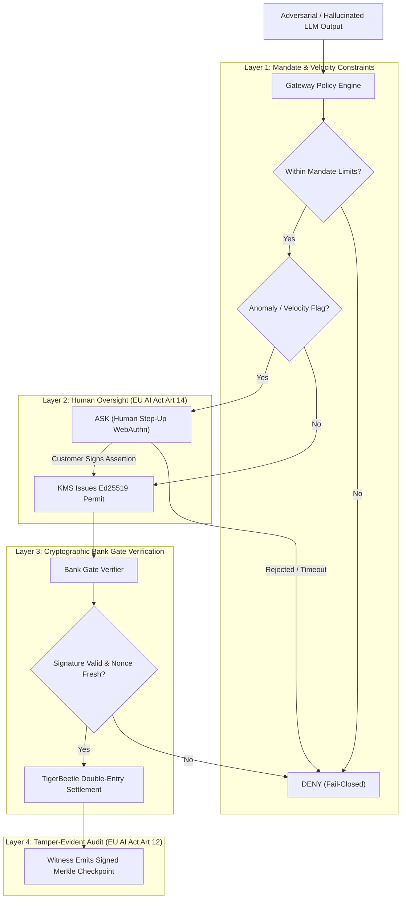

# EU AI Act & US Fed SR 11-7 Governance & Model Risk Mapping
**System:** AgentGuard AI Banking Security Platform  
**Target Frameworks:**  
1. European Union Artificial Intelligence Act (Regulation EU 2024/1689) — High-Risk AI System Guardrails  
2. US Federal Reserve SR 11-7 / OCC Bulletin 2011-12 — Supervisory Guidance on Model Risk Management  
**Scope:** AI Agent Autonomy Governance, Hallucination Containment, Human-in-the-Loop Safeguards, and Model Auditability.  
**Status:** Architectural and Technical Control Implementation Verified.

---

## 1. Executive Summary

When banks deploy autonomous AI agents (LLMs, reasoning frameworks, autonomous orchestrators) to initiate, negotiate, or reconcile financial transactions, these agents constitute **High-Risk AI Systems** under Annex III of the EU AI Act and **Models/Analytical Tools** subject to Federal Reserve SR 11-7 guidance.

AgentGuard AI acts as the non-bypassable, deterministic governance layer that constrains probabilistic AI behavior within mathematically provable, cryptographically signed limits.

---

## 2. EU AI Act (Regulation EU 2024/1689) Compliance Matrix

| EU AI Act Article | Statutory Obligation | AgentGuard Architectural & Code Safeguard | Verification Evidence |
|---|---|---|---|
| **Article 9: Risk Management System** | High-risk AI systems must implement continuous identification, evaluation, and mitigation of risks to safety and fundamental rights. | **Continuous Risk Scoring:** Multi-stage risk pipeline evaluates every agent request against client mandates, transaction velocity, historical baselines, and payee reputations. | `packages/gateway-mcp/src/detectors/banking-anomaly-detector.ts` `packages/gateway-mcp/src/services/permit-engine.ts` |
| **Article 12: Automatic Record-Keeping & Logging** | Automatic logging of events during system operation throughout its lifecycle to ensure traceability. | **Independent Witness Audit Trail:** Cryptographic logging with Ed25519 signatures, Merkle trees, and hash-chain checkpoints. Logs record exact prompt digests, permit parameters, and timestamps. | `packages/witness/src/services/witness-service.ts` `packages/witness/src/__tests__/witness.test.ts` |
| **Article 13: Transparency and Deployer Information** | AI systems must be sufficiently transparent to enable deployers to interpret system outputs and use them appropriately. | **Canonical Permit Payloads & Cockpit:** Structured JSON permits contain transparent, human-readable breakdown of amounts in paise, payee IDs, policy decisions, and anomaly reasoning. | `packages/core-schema/src/banking/index.ts` `apps/compliance-cockpit/` |
| **Article 14: Human Oversight ("Human-in-the-Loop")** | Natural persons must be able to oversee the system, intervene, override decisions, or immediately halt execution. | **ASK Decision & Transaction-Bound WebAuthn:** When risk thresholds are met, the system transitions to `ASK` state, demanding explicit human approval via WebAuthn passkey before any permit is signed or executed. | `packages/gateway-mcp/src/services/permit-engine.ts` `docs/TRANSACTION-BOUND-APPROVAL.md` |
| **Article 15: Accuracy, Robustness, and Cybersecurity** | High-risk systems must be resilient against errors, unexpected situations, adversarial attempts to exploit vulnerabilities, or model hallucinations. | **Deterministic Bank Gate Execution:** Even if an LLM is jailbroken or hallucinates an instruction, Bank Gate enforces fail-closed cryptographic signature verification, integer-paise math, and nonce consumption. | `packages/bank-gate/src/services/bank-gate.ts` `packages/bank-gate/src/__tests__/bank-gate.test.ts` |

---

## 3. Federal Reserve SR 11-7 / OCC 2011-12 Model Risk Management

| SR 11-7 Principle | Supervisory Requirement | AgentGuard Technical Control |
|---|---|---|
| **Sound Model Development & Implementation** | Rigorous boundary specification, input validation, and avoidance of undocumented model assumptions. | **Strict Schema Boundaries:** Zod schemas validate every parameter (`core-schema`). Floating-point currency calculations are rejected; integer paise are strictly enforced. |
| **Robust Model Validation & Boundary Testing** | Independent verification of outputs, stress testing, and boundary condition evaluation. | **Automated Stress Testing:** 500-transfer concurrent stress tests verify that ledger double-entry invariants, overdraft prevention, and nonce-uniqueness hold under heavy adversarial load. |
| **Governance, Policies & Control Procedures** | Independent validation, role segregation, and clear operational control boundaries. | **Zero-Trust Separation:** The Gateway (which interfaces with the AI agent) cannot directly execute financial transfers; only the isolated Bank Gate can commit transfers after signature validation. |

---

## 4. Architectural Safeguard Hierarchy

---

## 5. Compliance Verification Conclusion

By implementing these structural boundaries:
1. **AI Agents never have direct API keys or access to core banking ledgers.**
2. **Every financial action requires a mathematically verifiable permit signed by an enterprise-managed KMS.**
3. **High-risk actions require cryptographic human approval linked directly to the transaction details.**
4. **All actions produce tamper-evident, auditor-verifiable cryptographic proofs.**
