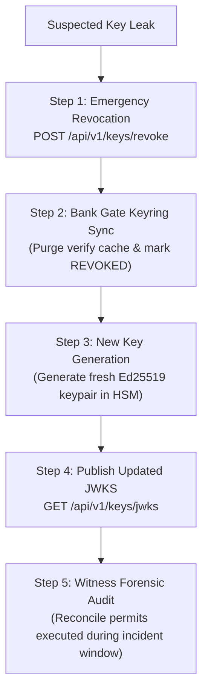

# Enterprise Incident Response & Key Compromise Playbook
**System:** AgentGuard AI Banking Security Platform  
**Target Audience:** Bank SecOps, Incident Responders, CISO, and Cloud Operations  
**Classification:** Restricted — Internal Security Operations  
**Compliance Mandate:** PCI DSS v4.0 (Req 12.10) & RBI Cyber Resilience Directions (Annex I & Para 11.5)

---

## 1. Overview & Incident Classification

This playbook governs operational procedures for 4 critical security scenarios in an AgentGuard deployment:

1. **Severity 1 (P0): Cryptographic Signing Key Compromise** (Gateway Ed25519 or KMS/HSM material leak).
2. **Severity 1 (P0): Rogue AI Agent Runaway** (Prompt injection, velocity loop, rapid mandate exhaustion).
3. **Severity 2 (P1): Ledger Network Partition or Database Inconsistency** (TigerBeetle consensus split).
4. **Severity 2 (P1): Tamper-Evident Audit Discrepancy** (Witness Merkle root mismatch or sequence regression).

---

## 2. Playbook 1: Cryptographic Signing Key Compromise (Severity 1)

### Trigger Conditions
- Suspected unauthorized access to KMS / HSM slot or Gateway host memory.
- Discovery of an unauthenticated permit signature presented to Bank Gate.
- Operator disclosure of private key credentials.

### Containment & Remediation Workflow



### Detailed Execution Steps

#### Step 1: Issue Emergency Revocation
Execute immediate revocation via protected Gateway API using dual-control administrative bearer credentials:

```bash
curl -X POST https://gateway.internal.bank/api/v1/keys/revoke \
  -H "Authorization: Bearer ${SECOPS_ADMIN_TOKEN}" \
  -H "Content-Type: application/json" \
  -d '{
    "key_id": "gw_key_compromised_id",
    "reason": "KEY_COMPROMISE",
    "operator_id": "secops_lead_01"
  }'
```

*Expected Result:* Key status transitions immediately to `REVOKED`. Gateway immediately terminates signing operations with this key.

#### Step 2: Trigger Instant Multi-Instance Invalidation at Bank Gate
Bank Gate instances periodically poll `/api/v1/keys/revocations`. To force immediate convergence across all distributed Bank Gate clusters:

```bash
# Push revocation sync signal to Bank Gate nodes
curl -X POST https://bank-gate.internal.bank/api/v1/admin/sync-revocations \
  -H "Authorization: Bearer ${BANKGATE_ADMIN_TOKEN}"
```

*Enforcement Check:* Bank Gate `TrustedKeyring` marks the key as `REVOKED`. Any subsequent permit presented bearing this `key_id` is rejected immediately (`KEY_REVOKED`). In addition, any permit presenting this key is rejected even if within the 180s grace window.

#### Step 3: Rotate to New Active Key in HSM
Provision a new active signing key:

```bash
curl -X POST https://gateway.internal.bank/api/v1/keys/rotate \
  -H "Authorization: Bearer ${SECOPS_ADMIN_TOKEN}" \
  -H "Content-Type: application/json" \
  -d '{
    "reason": "Post-compromise key rotation to fresh HSM slot",
    "operator_id": "secops_lead_01"
  }'
```

#### Step 4: Cryptographic Key Destruction (Post-Forensics)
Once law enforcement and forensic snapshots are taken:
1. Remove legal hold: `POST /api/v1/keys/legal-hold` (`legal_hold: false`).
2. Trigger memory zeroization: `POST /api/v1/keys/destroy`.
3. Verify SHA-256 destruction event digest logged in the audit trail.

---

## 3. Playbook 2: Rogue AI Agent Runaway & Mandate Exhaustion (Severity 1)

### Trigger Conditions
- LLM prompt injection or runaway recursive execution loop.
- Sudden spike in transfer request velocity (> 5 requests/sec from a single agent).
- Anomaly detector triggers `ANOMALOUS_VELOCITY` or `EXCESSIVE_TRANSFERS_WINDOW`.

### Containment & Remediation Workflow

1. **Automated Interception:**
   - Gateway `BankingAnomalyDetector` automatically trips state from `APPROVE` to `ASK` or `DENY`.
   - Autonomous agent is blocked from obtaining signed permits without human WebAuthn step-up authentication.

2. **Immediate Mandate Revocation (Operator or Customer Action):**
   ```bash
   curl -X POST https://gateway.internal.bank/api/v1/mandates/revoke \
     -H "Authorization: Bearer ${CUSTOMER_OR_OPS_SESSION}" \
     -H "Content-Type: application/json" \
     -d '{
       "mandate_id": "mandate_target_id",
       "reason": "Immediate freeze due to suspicious agent activity"
     }'
   ```

3. **Session Termination & Agent Disconnect:**
   - Invalidate agent bearer token and quarantine agent session in Redis / Gateway DB.
   - Bank Gate automatically rejects any previously issued permits for that mandate via nonce lookups.

---

## 4. Playbook 3: Ledger Partition & Reconciler Failover (Severity 2)

### Trigger Conditions
- TigerBeetle client emits `ETIMEDOUT` or `ECONNREFUSED`.
- Health check returns `LEDGER_DOWN`.

### Containment & Fail-Closed Guarantee
1. **Zero State Mutation:** Bank Gate execution engine is strictly **fail-closed**. If Ledger Adapter cannot commit the transfer, the execution FSM transitions to `FAILED_LEDGER_ERROR`. No balances are altered.
2. **Automatic Reconciliation Check:**
   - Reconciler compares Bank Gate committed intents with TigerBeetle committed transfer IDs.
   - Executes pending expiry: any permit pending execution beyond 90-second TTL is expired and unlocked.
3. **Cluster Health Verification:**
   ```bash
   # Inspect 3-node TigerBeetle consensus status
   docker exec -it tigerbeetle-0 /tigerbeetle status --addresses=172.28.0.2:3001,172.28.0.3:3001,172.28.0.4:3001
   ```

---

## 5. Playbook 4: Witness Audit Discrepancy & Forensics (Severity 2)

### Trigger Conditions
- Bank Gate or external auditor detects Merkle root mismatch (`INCLUSION_PROOF_MISMATCH`).
- Witness rejects checkpoint submission with `EPOCH_REGRESSION` or `SEQUENCE_REGRESSION`.

### Forensic Collection & Audit Export

1. **Export Cryptographic Evidence Pack:**
   ```bash
   # Generate portable compliance evidence bundle for suspect transaction
   curl -X GET https://witness.internal.bank/api/v1/compliance/evidence/${SUSPECT_PERMIT_ID} \
     -H "Authorization: Bearer ${AUDIT_TOKEN}" \
     -o evidence_pack_${SUSPECT_PERMIT_ID}.json
   ```

2. **Run Standalone Offline Verification:**
   ```bash
   curl -X POST https://witness.internal.bank/api/v1/compliance/evidence/verify \
     -H "Content-Type: application/json" \
     -d @evidence_pack_${SUSPECT_PERMIT_ID}.json
   ```

3. **Check Witness Detached Key History:**
   Query `GET /api/v1/public-key` and review `witness_key_history` to verify that older checkpoints align with historically rotated public keys.

---

## 6. Regulatory Incident Reporting Timelines & Authoritative Sources

| Regulatory Authority | Statutory Instrument / Circular | Incident Category | Reporting Window | Reporting Channel / Format |
|---|---|---|---|---|
| **CERT-In (MeitY)** | Cyber Security Directions 2022 (No. 20(3)/2022-CERT-In) Section 70B(6) IT Act 2000 | Any cybersecurity incident (unauthorized access, key compromise, rogue agent intrusion) | **Within 6 hours** of noticing or being brought to notice | Incident Reporting Form to incident@cert-in.org.in |
| **Reserve Bank of India (RBI)** | Master Direction `DoS.CO.CSITE.SEC.No.1852/22.01.039/2023-24` (IT Governance, Risk & Controls, Chapter IV) & Circular `DBS.CO.CY.PD.No.11/04.09.001/2015-16` | Severity 1 Cyber Incidents, payment outages, rogue automation, or cryptographic compromise | **Immediate notification / 2 to 6 hours** for initial CSIR | Prescribed Cyber Security Incident Reporting (CSIR) template to RBI Cyber Security Incident Tracking Cell (CSITE) at csite@rbi.org.in |
| **RBI CSITE Follow-up** | RBI Master Direction Chapter IV Para 22 | Detailed Root-Cause Analysis (RCA) & forensic remediation | **Within 24 hours** (preliminary RCA), closure report within 14 days | Detailed technical report to RBI CSITE |
| **Payment Card Industry (PCI)** | PCI DSS v4.0 Requirement 12.10.5 | Compromise or suspected breach of cardholder or account settlement data | **Within 24 hours** of breach confirmation | Acquiring banks, payment brand security teams (Visa, Mastercard, RuPay) |

> [!CAUTION] Regulatory Entity Distinction:
> Note that **CERT-In** (Ministry of Electronics and Information Technology) and **RBI CSITE** (Reserve Bank of India Cyber Security Incident Tracking Cell) are separate statutory bodies with distinct reporting formats and channels. Commercial banks and regulated entities must report simultaneously to **both** authorities under their respective statutory jurisdictions. Do not conflate them as a single body.
