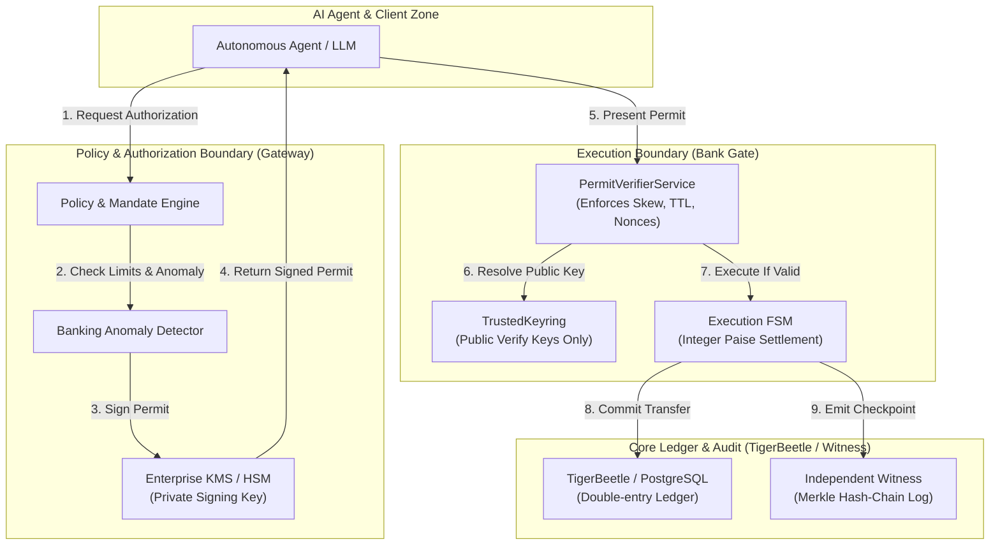

# PCI DSS v4.0 Compliance Mapping & Technical Controls Matrix
**System:** AgentGuard AI Banking Security Platform  
**Target Standard:** Payment Card Industry Data Security Standard (PCI DSS) Version 4.0  
**Scope:** Banking Gateway (`gateway-mcp`), Bank Gate Execution Boundary (`bank-gate`), Ledger Adapter (`ledger-adapter`), and Independent Witness (`witness`).  
**Status:** Architectural and Technical Control Implementation Verified.  
*Disclaimer: This document establishes technical and architectural alignment with PCI DSS v4.0 requirements. Formal compliance certification requires an independent assessment by a certified Qualified Security Assessor (QSA).*

---

## 1. Executive Summary

AgentGuard AI acts as a secure, fail-closed authorization and enforcement boundary between autonomous AI agents and core banking transaction infrastructure. By decoupling agent policy evaluation (Gateway) from cryptographic permit verification and execution (Bank Gate), AgentGuard guarantees that no autonomous agent can directly mutate bank balances or bypass organizational access controls.

This document details the mapping between PCI DSS v4.0 technical specifications and AgentGuard's source code, cryptographic key lifecycle, and audit safeguards.

---

## 2. Technical Control Mapping Matrix

### Requirement 3: Protect Stored Account Data

| PCI DSS v4.0 Req | Requirement Description | AgentGuard Technical Control | Source Verification & Tests |
|---|---|---|---|
| **3.2.1** | Account data storage is kept to the minimum necessary through retention and disposal policies. | AgentGuard does not store Primary Account Numbers (PANs) or sensitive authentication data (SAD). Balances and accounts are tracked as integer paise in tenant-partitioned ledger accounts. Ledger entries use UUID identifiers and SHA-256 digests. | `packages/core-schema/src/banking/index.ts` `packages/bank-gate/src/services/permit-verifier.ts` |
| **3.5.1** | Protect cryptographic keys used to protect stored account data against disclosure and misuse. | Gateway private signing keys are isolated in the `KmsProvider` abstraction. Production deployments enforce HSM backing via `Pkcs11HsmProvider`. Test-only `MockHsmProvider` is permanently locked out in production. | `packages/gateway-mcp/src/crypto/kms-provider.ts` `packages/gateway-mcp/src/__tests__/key-management-rotation.test.ts` |
| **3.6.1** | Key management procedures for cryptographic keys used to protect account data. | Comprehensive Key Lifecycle Finite State Machine implemented: `PRE_ACTIVE` &rarr; `ACTIVE` &rarr; `RETIRED` &rarr; `PENDING_DESTRUCTION` &rarr; `DESTROYED`. State transitions are strictly validated. | `packages/core-schema/src/banking/kms-schema.ts` `packages/gateway-mcp/src/crypto/kms-provider.ts` |
| **3.6.1.1** | Generation of strong cryptographic keys using industry-accepted algorithms. | Signing keys use Ed25519 (EdDSA over Curve25519) and RSA/ECDSA via standard PKCS#11 KMS endpoints. Ed25519 provides 128-bit post-quantum security margin with zero parameter malleability. | `packages/gateway-mcp/src/crypto/kms-provider.ts` |
| **3.6.1.2** | Secure cryptographic key distribution. | Public verification keys are distributed via RFC 7517 JSON Web Key Sets (`GET /api/v1/keys/jwks`) with explicit `key_ops: ["verify"]` and activation/retirement timestamps. Bank Gate maintains a localized `TrustedKeyring`. | `packages/gateway-mcp/src/api/keys.ts` `packages/bank-gate/src/services/trusted-keyring.ts` |
| **3.6.1.3** | Secure cryptographic key storage. | Private keys are zeroized in memory upon destruction using `Buffer.fill(0)`. No private key material is ever logged or returned via public APIs. | `packages/gateway-mcp/src/crypto/kms-provider.ts` |
| **3.6.1.4** | Cryptographic key rotation at end of cryptoperiod. | Zero-downtime rotation with 180-second transition grace period. Retired keys can **only** verify permits minted prior to retirement (`permit.issued_at <= key.retired_at`). Fresh permits signed with retired keys are rejected immediately. | `packages/bank-gate/src/services/trusted-keyring.ts` `packages/bank-gate/src/__tests__/keyring-rotation.test.ts` |
| **3.7.1** | Revocation and destruction of cryptographic keys. | Immediate emergency revocation (`POST /api/v1/keys/revoke`). Bank Gate polls or receives invalidation via `GET /api/v1/keys/revocations` with `no-cache` directives. Key destruction enforces legal hold verification and SHA-256 audit digests. | `packages/gateway-mcp/src/api/keys.ts` `packages/core-schema/src/banking/kms-schema.ts` |

---

### Requirement 7 & 8: Access Control and Identification

| PCI DSS v4.0 Req | Requirement Description | AgentGuard Technical Control | Source Verification & Tests |
|---|---|---|---|
| **7.2.1** | Access model defines access based on need to know and role. | Scoped Customer Mandates define strict per-transaction and cumulative integer-paise limits, allowed payee categories, and time bounds. Agent permissions are strictly delegated and revokable. | `packages/gateway-mcp/src/__tests__/customer-mandates.test.ts` `packages/core-schema/src/banking/index.ts` |
| **7.2.4** | Multi-tenant isolation and data segregation. | PostgreSQL Row-Level Security (RLS) enforces `tenant_id` session scoping (`SET LOCAL app.current_tenant_id`). Direct queries across tenant boundaries return zero rows. | `packages/gateway-mcp/src/__tests__/tenant-isolation-rls.test.ts` `docs/PHASE-7.2-MULTI-TENANCY-RLS.md` |
| **8.3.1** | Multi-factor authentication (MFA) for access. | Enterprise OIDC with Authorization Code + PKCE flow for administrative and customer sessions. | `packages/gateway-mcp/src/__tests__/enterprise-auth.test.ts` `docs/ENTERPRISE-AUTH-ARCHITECTURE.md` |
| **8.4.2** | Transaction-bound step-up authentication. | FIDO2 / WebAuthn passkey assertion cryptographically bound to the canonical transaction digest (`SHA-256(tenant_id \| mandate_id \| amount_paise \| payee \| nonce)`). Bypassing human approval triggers immediate permit rejection. | `packages/gateway-mcp/src/services/permit-engine.ts` `docs/TRANSACTION-BOUND-APPROVAL.md` |

---

### Requirement 10: Log and Monitor All Access to System Components

| PCI DSS v4.0 Req | Requirement Description | AgentGuard Technical Control | Source Verification & Tests |
|---|---|---|---|
| **10.2.1** | Audit logs capture all user and administrative actions. | Every authorization request, anomaly flag, policy evaluation, and key lifecycle transition generates an immutable audit record. | `packages/gateway-mcp/src/api/keys.ts` `packages/witness/src/services/witness-service.ts` |
| **10.2.2** | Audit logs are tamper-resistant and protected against modification. | Independent Witness Service maintains an append-only SQLite/PostgreSQL ledger with SHA-256 hash chaining and Ed25519 digital signatures. Periodic Merkle checkpoints are signed and preserved. | `packages/witness/src/__tests__/witness.test.ts` `packages/core-schema/src/provenance.test.ts` |
| **10.3.1** | Audit log details include user identification, event type, date and time, success/failure. | Witness logs record `event_type`, `tenant_id`, `actor_id`, `canonical_payload_hash`, `timestamp_ms`, `sequence_number`, and `prev_checkpoint_hash`. | `packages/witness/src/services/witness-service.ts` |
| **10.5.1** | Time synchronization across all system components. | Strict timestamp validation: clock skew bounded to maximum 5,000ms. Future-dated permits and permits exceeding maximum TTL (90s) are rejected fail-closed. | `packages/bank-gate/src/services/permit-verifier.ts` `packages/bank-gate/src/__tests__/keyring-rotation.test.ts` |

---

## 3. Cryptographic Separation Architecture

The core tenet of PCI DSS compliance within AgentGuard is strict cryptographic segregation:

**Key Isolation Invariant:**
- Bank Gate **never** possesses or accesses Gateway private keys.
- Gateway **cannot** mutate ledger state directly; it can only emit signed permits.
- If Gateway is compromised, permits presented to Bank Gate must still satisfy mandate limits, nonces, and unexpired validity windows.
